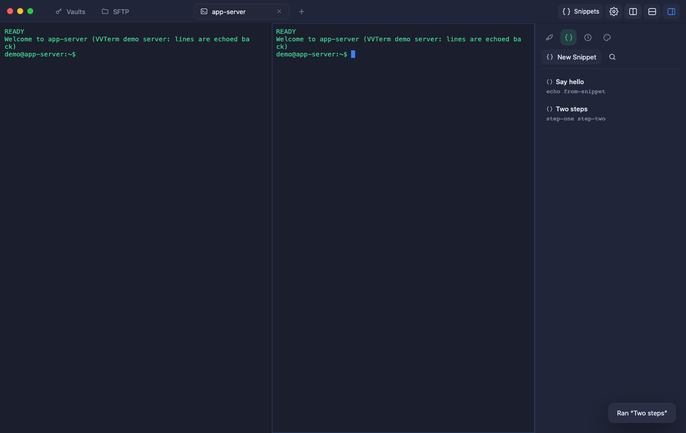
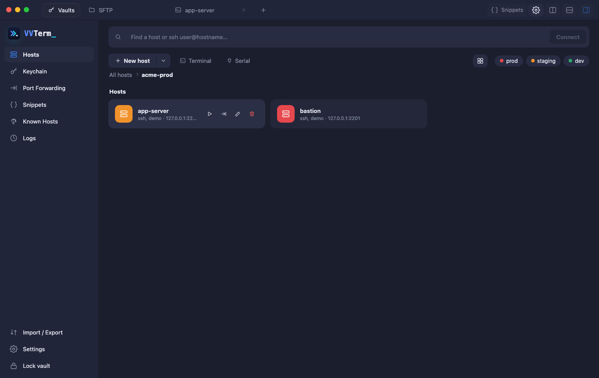
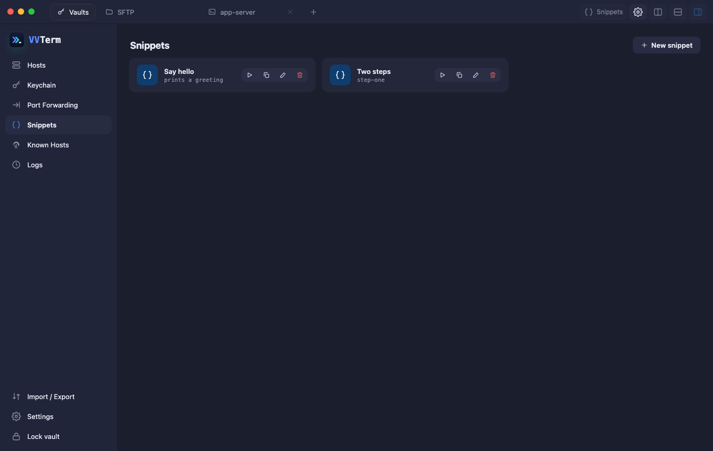
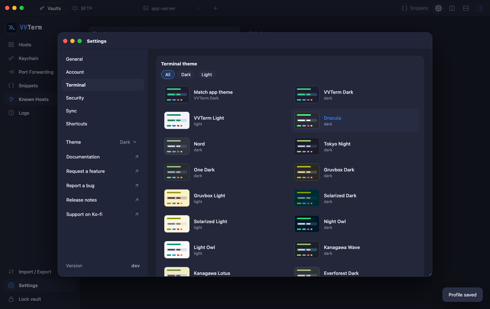

<p align="center"></p>

<p align="center">
  <a href="https://ko-fi.com/vunguyenvu"></a>
</p>

<p align="center">
  <b>An SSH client for people who want to own their data.</b><br>
  Hosts, keys and passwords live in an encrypted vault on your Mac, export to standard formats at any time, and sync through a private Git repository you control.
</p>

<p align="center"></p>

## What you can do

- **Add hosts the easy way.** A docked form (no popups) with **Test connection**, so you know the address, credentials and jump host work before you save, and **Connect** that saves and opens the terminal in one step.
- **Organise hosts** in groups, with tags and a colour per environment (prod / staging / dev). Find anything from one search box, or type `ssh user@host` to connect right away.
- **Keep secrets safe.** Private keys and passwords are encrypted with your master password. The interface never sees them.
- **Work in tabs and split panes**, through one or more jump hosts, with keep-alive and one-key reconnect.
- **Browse and transfer files with SFTP** in a tab of its own: upload, download, create, rename and delete, with confirmation before anything is replaced.
- **Save snippets** of commands you run often and type them into any terminal with a click.
- **Make it yours**: 26 terminal colour themes, light / dark / auto appearance, font, cursor and scrollback, interface zoom, your own keyboard shortcuts, all in a Settings window of its own.
- **Forward ports**: local, remote and SOCKS5 proxy.
- **Stay in control.** Import and export your `~/.ssh/config`, share a host list without secrets, make encrypted backups, or sync between your Macs through a private Git repository.

<table>
  <tr>
    <td width="50%"><br><sub>Hosts and groups</sub></td>
    <td width="50%"><br><sub>Snippets</sub></td>
  </tr>
  <tr>
    <td><br><sub>New host: Test connection, Save or Connect</sub></td>
    <td><br><sub>Settings window and terminal themes</sub></td>
  </tr>
</table>

## Try it

**Requirements:** a Mac. VVTerm is currently a beta for macOS only.

### 1. Install

- **From a release (recommended):** download `VVTerm-<version>-macos-<arch>.zip` from the [Releases](../../releases) page, unzip it and drag **VVTerm.app** to *Applications*.
- **From source:** see the [Development guide](docs/Development.md) (three commands).

> **First launch.** Beta builds are not notarized by Apple yet, so macOS may say the app *"can't be opened"*. Right-click **VVTerm.app → Open → Open** once. This is only needed the first time.

### 2. First five minutes

1. **Create your vault.** Choose a master password (12+ characters). It cannot be recovered, so keep it safe.
2. **Add a credential** in **Keychain**: generate a new key (copy the public key to your server's `~/.ssh/authorized_keys`), import an existing key, or save a password.
3. **Add a host** with **New host**: address, username and a password (or the key you just made). Press **Test connection** to check it, then **Connect** to save and open it. Optionally pick a group, an environment colour or a jump host.
4. **Connect**: double-click a saved host any time. The first time, check the server fingerprint and choose *Trust and connect*.
5. **Make it yours**: save a **Snippet**, split the pane, open **Port Forwarding**, import your existing `~/.ssh/config` from **Import / Export**, or open **Settings** (⌘/Ctrl + ,) to pick a terminal theme.

The [User guide](docs/UserGuide.md) walks through every screen with screenshots.

### No server to test with?

Start two throw-away demo SSH servers on your Mac (needs Docker):

```bash
docker compose --profile dev up -d
```

Add hosts `127.0.0.1` port `2201` (bastion) and `2202`, username `demo`, password `demo-password`. They echo whatever you type, which is enough to try tabs, jump hosts, snippets and forwards. Stop them with `docker compose --profile dev down`.

## Your data and your security

| | |
| --- | --- |
| **Where it lives** | `~/Library/Application Support/vvterm/` (one SQLite database plus a `known_hosts` file) |
| **What is encrypted** | Keys and passwords: AES-256-GCM, with a key derived from your master password (Argon2id) |
| **What leaves your Mac** | Nothing, unless you turn on Git sync, which only uploads encrypted data to *your* repository |
| **Unknown servers** | You confirm the fingerprint once. If a known server's key ever changes, the connection is **blocked with no override** |
| **Forwards** | Listen on `127.0.0.1` only, unless you explicitly allow more |
| **Auto-lock** | The vault locks after 15 idle minutes (configurable) |

Back up regularly with **Import / Export → Encrypted backup**.

**Forgot your master password?** It cannot be recovered. On the unlock screen choose *Forgot password?* to reset the vault: saved keys and passwords are erased, while hosts, groups, snippets and port forwards are kept. If you have an encrypted backup, restore it afterwards.

## Known limitations of this beta

- macOS only; Windows and Linux are not built or tested yet.
- "Keychain unlock" stores the vault key in the macOS Keychain; it does **not** require Touch ID yet.
- The vault does not lock when the Mac sleeps (only on idle).
- Settings opens as a second window of the app (a second process): it shows a second Dock icon while open and needs the main app running.
- SFTP transfers single files only (no folder transfer, queue or resume yet).
- Git sync was tested with local repositories, not yet with every hosting provider.
- `ProxyCommand` and `Match` blocks in `~/.ssh/config` are reported as warnings on import and skipped.

The full list is in the [release notes](RELEASE_NOTES.md).

## Feedback and bug reports

Your feedback is the point of this beta. Please [open an issue](../../issues/new) and include:

- what you did, what you expected and what happened (a screenshot helps);
- your VVTerm version and macOS version;
- **never** paste passwords, private keys or your vault file.

## Support VVTerm

VVTerm is free and open source, built and maintained in spare time. If it saves you time, you can help keep it going:

<p align="center">
  <a href="https://ko-fi.com/vunguyenvu"></a>
</p>

Stars, bug reports and pull requests help just as much.

## Documentation

| | |
| --- | --- |
| [User guide](docs/UserGuide.md) | every feature, with screenshots |
| [Release notes](RELEASE_NOTES.md) | what is new, quality results, known issues |
| [Development guide](docs/Development.md) | build, test, Docker, deploy |
| [Architecture](docs/CleanArchitecture.md) | layers, decisions, technical debt |
| [Assessment](docs/Assessment.md) | honest comparison with the original design |

## License

See [LICENSE](LICENSE).
