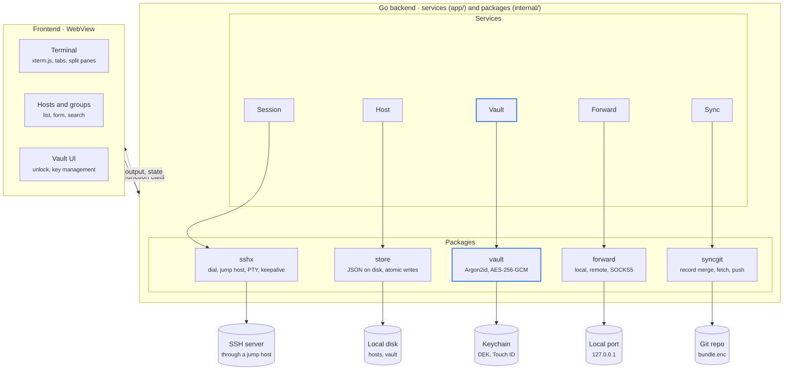
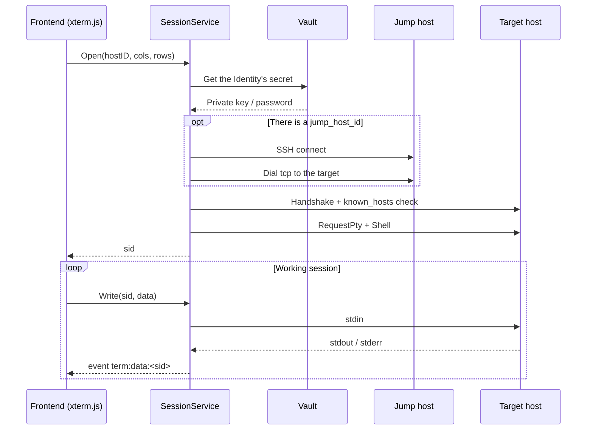

# VVTerm — Architecture design document

> Updated: 2026-10-28 · Author: Vũ Nguyễn Vũ

> **Implementation note (2026-10-28).** This is the original design, kept as written (translated into English). The implementation deviates in a few places; the decisions are recorded in [CleanArchitecture.md](CleanArchitecture.md) (ADR-0001 SQLite instead of JSON files, ADR-0002 clean architecture and package layout, ADR-0003 own `ssh_config` parser) and the full comparison is in [Assessment.md](Assessment.md). Open questions: frontend = React + TypeScript; SFTP and team sharing stay out of scope.

## Contents

1. [Overview](#1-overview)
2. [Technology choices](#2-technology-choices)
3. [Overall architecture](#3-overall-architecture)
4. [Data model](#4-data-model)
5. [Security and the vault](#5-security-and-the-vault)
6. [SSH flow](#6-ssh-flow)
7. [Import/export and sync](#7-importexport-and-sync)
8. [Project structure and API bindings](#8-project-structure-and-api-bindings)
9. [Roadmap, risks and open questions](#9-roadmap-risks-and-open-questions)

---

## 1. Overview

VVTerm is a desktop SSH client whose data the user controls and can always export. Hosts and keys are never locked inside the app: everything can be exported in a standard format, and synced through the user's own Git repository.

**Goals**

- Manage hosts by group, tag and environment colour (dev, staging, production).
- A vault that stores private keys and passwords, encrypted with a master password.
- Multi-tab terminal, split panes, jump hosts, port forwarding.
- Import and export `~/.ssh/config` and encrypted JSON files, so data is never locked in.
- Sync between machines through a private Git repository that the user owns.

**Out of scope for the MVP**

- SFTP browser, command snippets, session history, mobile app.
- Sharing hosts within a team, and permissions.
- Telnet, serial, RDP, VNC.

Preferred platform: macOS. Windows and Linux build, but are not tested thoroughly in the MVP.

---

## 2. Technology choices

The choice is **Wails v2 + Go** for the backend and **xterm.js** for the terminal: it builds on the Go knowledge already in the team, has a standard SSH library, and produces a lighter binary than Electron because it uses the operating system's WebView.

| Criterion | Wails + Go | Electron + Node | Tauri + Rust |
| --- | --- | --- | --- |
| SSH library | golang.org/x/crypto/ssh | ssh2 | russh |
| WebView | WKWebView (macOS) | Bundled Chromium | WKWebView (macOS) |
| App weight | Light | Heaviest | Lightest |
| Fit for the team | High (already uses Go) | Medium | Low (Rust must be learned) |
| Existing references | Few | Tabby, Electerm | Few |

**Main components**

- Frontend: Svelte or React + TypeScript, xterm.js with the `fit`, `search` and `web-links` addons.
- SSH: `golang.org/x/crypto/ssh`, `golang.org/x/crypto/ssh/agent`, `golang.org/x/crypto/ssh/knownhosts`.
- Encryption: `golang.org/x/crypto/argon2`, `crypto/aes` + `crypto/cipher` (GCM).
- Keychain: `github.com/zalando/go-keyring` (macOS Keychain, Windows Credential Manager, Secret Service on Linux).
- ssh config parsing: `github.com/kevinburke/ssh_config`.
- Git sync: call the `git` CLI already on the machine, or `github.com/go-git/go-git/v5` to avoid the dependency.
- Storage: JSON files on disk; SQLite is not needed in the MVP.

Wails risk: WebViews differ between operating systems, so xterm.js may render differently; fonts and performance with large output (for example `tail -f` on a log) must be tested.

---

## 3. Overall architecture

The application has three tiers: the frontend in the WebView, which only displays; the Go backend, which holds all connections and secrets; and the components outside the app.



Session and Sync also call the Vault to obtain a secret or the DEK inside Go; the frontend only receives metadata, terminal output and state. The vault is the only place that holds decrypted secrets.

---

## 4. Data model

Data is split in two: non-secret configuration (hosts, groups) is stored as plain JSON, while secrets (keys, passwords) live in the encrypted vault. A host only references an Identity by ID and never contains a secret.

| Entity | Main fields | Stored in |
| --- | --- | --- |
| Group | id, name, parent_id, color, sort_order | `hosts.json` |
| Host | id, label, group_id, hostname, port, username, identity_id, jump_host_id, env (dev/staging/prod), tags[], keepalive_sec, created_at, updated_at | `hosts.json` |
| PortForward | id, host_id, type (local/remote/dynamic), bind_addr, bind_port, dest_host, dest_port, auto_start | `hosts.json` |
| Identity | id, name, username, auth_type (key/password/agent), secret_ref | `hosts.json` (metadata) |
| Secret | id, kind (private_key/password/passphrase), ciphertext, nonce | `vault.json` |
| KnownHost | hostname:port, key_type, fingerprint | `known_hosts` (OpenSSH format) |

**Data directory layout** (macOS: `~/Library/Application Support/vvterm/`)

```
data/
  hosts.json        # groups, hosts, port forwards, identity metadata
  vault.json        # encrypted secrets + KDF header
  known_hosts       # OpenSSH format
  settings.json     # theme, font, shortcuts (not synced)
sync/               # Git working copy, holds encrypted files only
```

Every record has an `id` (UUID v7) and an `updated_at`, used to merge on sync. Deletion uses a tombstone (`deleted_at`) instead of a hard delete, so that other machines learn that the record was removed.

---

## 5. Security and the vault

The vault uses envelope encryption: one random data key (DEK) encrypts every secret, and the master password is only used to wrap the DEK. Changing the master password only requires wrapping the DEK again, not re-encrypting all the secrets.

**Encryption flow**

1. When the vault is created: generate a 16-byte `salt` and a 32-byte DEK with `crypto/rand`.
2. KEK = Argon2id(master password, salt), with the proposed parameters m = 64 MiB, t = 3, p = 4 and a 32-byte output. The parameters are stored in the header so they can be raised later.
3. The DEK is wrapped with AES-256-GCM using the KEK; `wrapped_dek` + `nonce` are stored in the `vault.json` header.
4. Each secret is encrypted separately with AES-256-GCM using the DEK and a random 12-byte nonce; the `secret.id` is used as AAD so that ciphertexts cannot be swapped between records.

**Quick unlock**

- Optionally store the DEK in the macOS Keychain, requiring Touch ID or the machine password to read it.
- Lock the vault automatically after N minutes of inactivity and when the machine sleeps; the DEK is erased from memory when the vault locks.

**Host authentication**

- Verify the host key with `knownhosts.New`; for a new host, show the SHA256 fingerprint for the user to confirm.
- If a host key changes, block the connection and warn; there is no "ignore" button by default.
- Never use `ssh.InsecureIgnoreHostKey()`.

**Threat model**

| Threat | Mitigation |
| --- | --- |
| Leak of the sync repository or a backup file | Secrets are encrypted; `hosts.json` is also encrypted when synced so that internal IP addresses are not exposed |
| Brute-forcing the master password | Argon2id with strong parameters; a minimum length is required |
| MITM while connecting | Strict known_hosts verification |
| XSS in the frontend (for example malicious terminal output) | The frontend never receives secrets; Go keeps them and only returns metadata; strict CSP |
| The machine is taken over while the vault is open | Automatic lock after a time and on sleep |

Not protected against: malware already running on the machine with the user's rights, which can read memory while the vault is open.

---

## 6. SSH flow

Each terminal tab is a `Session` in Go with its own `sid`; data flows both ways through Wails: output as events, input as bindings. The frontend never holds a socket or a secret.

**Connecting to a host**

1. The frontend calls `SessionService.Open(hostID, cols, rows)` and receives a `sid`.
2. Go reads the Host, decrypts the Identity from the vault, and builds an `ssh.ClientConfig` with a `HostKeyCallback` backed by known_hosts.
3. If there is a `jump_host_id`: connect to the jump host first, then open a channel to the target through it (see the code below). A chain of several jump hosts is supported by recursion, with a depth limit to avoid loops.
4. Open a `session`, `RequestPty("xterm-256color", rows, cols, modes)`, then `Shell()`.
5. A goroutine reads stdout/stderr in chunks and emits the `term:data:<sid>` event; the frontend calls `term.write()`.
6. Keystrokes from xterm.js go through `SessionService.Write(sid, data)` into stdin.
7. When the window is resized: the `fit` addon recomputes cols/rows and calls `Resize(sid, cols, rows)` → `session.WindowChange`.
8. When the tab is closed or the remote exits: close the session, the client and the related port forwards; emit `term:closed:<sid>`.



```go
// Connect to the target through a jump host
func dialVia(jump *ssh.Client, addr string, cfg *ssh.ClientConfig) (*ssh.Client, error) {
	conn, err := jump.Dial("tcp", addr)
	if err != nil {
		return nil, err
	}
	c, chans, reqs, err := ssh.NewClientConn(conn, addr, cfg)
	if err != nil {
		conn.Close()
		return nil, err
	}
	return ssh.NewClient(c, chans, reqs), nil
}
```

**Port forwarding**

| Type | How it is done in Go | Example use |
| --- | --- | --- |
| Local (-L) | `net.Listen` on this machine; for each connection call `client.Dial` to the target, then `io.Copy` both ways | Forward MariaDB 3306 or Redis 6379 to localhost |
| Remote (-R) | `client.Listen` on the server; for each connection `net.Dial` back to this machine | Let a server call a webhook on the developer machine |
| Dynamic (-D) | A local SOCKS5 server; each request calls `client.Dial` | Browse an internal website through a bastion |

By default the bind address is `127.0.0.1`; `0.0.0.0` is not bound unless the user explicitly turns it on.

**Keep-alive and reconnecting**

- Send `keepalive@openssh.com` every `keepalive_sec`; several unanswered probes count as a lost connection.
- When the connection is lost: keep the terminal contents and show the banner "Press Enter to reconnect"; never reconnect automatically, to avoid running commands again unexpectedly.
- Port forwards with `auto_start` are rebuilt after a successful reconnect.

---

## 7. Import/export and sync

All data must be available in a standard format without the app; sync only pushes encrypted files to the user's private Git repository.

**Import**

| Source | Mapping |
| --- | --- |
| `~/.ssh/config` | `Host` → Host; `HostName`, `Port`, `User`; `IdentityFile` → import the key into the vault; `ProxyJump` → jump_host_id; `LocalForward`/`RemoteForward`/`DynamicForward` → PortForward; `Include` is followed |
| A key directory | Pick private key files, ask for the passphrase if there is one, store them in the vault |
| Encrypted JSON backup file | Restore everything, ask for the backup password |

When importing from an ssh config, the group is taken from the file name in `config.d/` (for example `acme-prod` → group `acme-prod`). A host with the same name prompts to overwrite, skip or create a copy.

**Export**

| Format | Contents | Notes |
| --- | --- | --- |
| `ssh config` | Hosts, groups (one file per group), jump hosts, port forwards | Keys are exported to separate files only if the user ticks the option, with a warning, `chmod 600` |
| Encrypted JSON | All data including secrets | The backup password is set separately at export time; it is not the master password |
| Plain JSON | Metadata only, no secrets | Used to share a host list |

**Sync through Git**

The repository only contains `bundle.enc` (hosts + vault, encrypted with the DEK) and `vault-header.json` (salt, Argon2id parameters, wrapped DEK). A new machine clones the repository and enters the master password to unlock the DEK, and then has all the data.

1. `git fetch` and read `bundle.enc` at `origin/main`.
2. Decrypt and merge with the local data record by record.
3. Encrypt again, commit on top of `origin/main`, `git push`.
4. If the push is rejected because another machine just pushed: go back to step 1, a few times at most, then report an error.

**Conflict handling**

Ciphertext cannot be merged by Git, so the app merges at record level:

- A record that exists on only one side → keep it.
- A record on both sides → take the one with the newer `updated_at` (last-write-wins).
- A tombstone newer than an edit → delete; an edit newer than the tombstone → restore.
- Clock skew between machines can give the wrong order; this is accepted in the MVP because one person rarely edits the same host on two machines at the same time.

`settings.json` and `known_hosts` are not synced in the MVP.

---

## 8. Project structure and API bindings

The Go code is split by service; each service is a struct that Wails binds to the frontend. The logic lives in `internal/` and does not depend on Wails, so it can be tested with `go test`.

```
vvterm/
  main.go                 # start Wails, register services
  app/                    # thin adapter: services bound to the frontend
    host_service.go
    vault_service.go
    session_service.go
    forward_service.go
    sync_service.go
  internal/
    model/                # Host, Group, Identity, PortForward, Secret
    store/                # read/write JSON, atomic file writes (tmp + rename)
    vault/                # Argon2id, AES-GCM, keychain
    sshx/                 # dial, jump host, pty, keepalive, known_hosts
    forward/              # local, remote, SOCKS5
    importer/             # ssh config, backup
    exporter/
    syncgit/              # fetch, record merge, push
  frontend/
    src/
      lib/terminal/       # xterm.js wrapper, tabs, split panes
      lib/hosts/          # list, groups, form
      lib/vault/          # unlock screen, key management
      wailsjs/            # generated bindings
```

**API bindings**

| Service | Methods | Notes |
| --- | --- | --- |
| VaultService | `Status()`, `Create(pw)`, `Unlock(pw)`, `UnlockBiometric()`, `Lock()`, `ChangePassword(old, new)` | No method returns a secret to the frontend |
| VaultService | `ListIdentities()`, `AddKey(name, path, passphrase)`, `AddPassword(name, user, pw)`, `GenerateKey(name, type)`, `PublicKey(id)` | `GenerateKey` generates an ed25519 key and only returns the public key to copy |
| HostService | `ListGroups()`, `SaveGroup(g)`, `DeleteGroup(id)`, `ListHosts(filter)`, `SaveHost(h)`, `DeleteHost(id)` | Delete = tombstone |
| SessionService | `Open(hostID, cols, rows) → sid`, `Write(sid, data)`, `Resize(sid, cols, rows)`, `Close(sid)` | Output through the `term:data:<sid>` event |
| SessionService | `TrustHostKey(sid, fingerprint)` | The answer to a `term:hostkey:<sid>` event |
| ForwardService | `Start(forwardID)`, `Stop(forwardID)`, `List()` | State through the `forward:state` event |
| SyncService | `Configure(repoURL)`, `SyncNow()`, `Status()` | Git authentication uses the SSH agent or a credential helper already on the machine |
| ImportExportService | `ImportSSHConfig(path)`, `ExportSSHConfig(dir, withKeys)`, `ExportBackup(path, pw)`, `ImportBackup(path, pw)` | |

**Events from Go to the frontend**

- `term:data:<sid>` — output, batched in chunks of about 16 ms so that large output does not flood the events.
- `term:hostkey:<sid>` — a fingerprint needs confirming.
- `term:closed:<sid>` — the session ended, with the reason.
- `vault:locked` — the vault locked itself; the frontend returns to the unlock screen.

---

## 9. Roadmap, risks and open questions

The work is delivered in four phases; move to the next phase only after passing the gate of the previous one. No time estimate is given for each phase yet.

```mermaid
flowchart LR
    P0["Phase 0 · Foundation<br/>Wails skeleton + store<br/>Vault: create, unlock<br/>Host and group CRUD"]
    G1{{"Gate 1<br/>The vault opens, a host can be saved"}}
    P1["Phase 1 · Terminal<br/>SSH, PTY, multiple tabs<br/>known_hosts<br/>Jump host, keepalive"]
    G2{{"Gate 2<br/>SSH through a real bastion"}}
    P2["Phase 2 · Forwarding and data<br/>Port forwarding<br/>Import ssh config<br/>Export config, backup"]
    G3{{"Gate 3<br/>All hosts have been moved over"}}
    P3["Phase 3 · Sync and polish<br/>Sync through Git<br/>Keychain, Touch ID<br/>Auto-lock, split panes"]:::final
    G4{{"Gate 4<br/>Used every day"}}:::final

    P0 --> G1 --> P1 --> G2 --> P2 --> G3 --> P3 --> G4

    classDef final stroke:#2f6fdb,stroke-width:2px;
```



After Gate 2 it is usable every day for basic SSH; Gate 4 is when VVTerm has enough features to be the main SSH tool.

**Risks**

| Risk | Impact | Response |
| --- | --- | --- |
| xterm.js on WKWebView is slow with large output | Lag during `tail -f` on a log | Batch events in chunks; measure performance as early as phase 1 |
| Old keys (RSA SHA-1, DSA) are not compatible with `x/crypto/ssh` | Cannot log in to old servers | Support `rsa-sha2-256/512`; say clearly when a key is not supported |
| Forgotten master password | The whole vault is lost | Warn when the vault is created; remind the user to export a backup regularly |
| Clock skew between machines when syncing | An edit may be overwritten by mistake | Accepted in the MVP; a version vector can be used later |

**Open questions**

- [x] App name: **VVTerm** (repo `vvterm`, CLI `vvt`)
- [ ] Svelte or React for the frontend?
- [ ] Should SFTP come earlier than phase 3?
- [ ] Personal use only, or will hosts be shared with a team?
