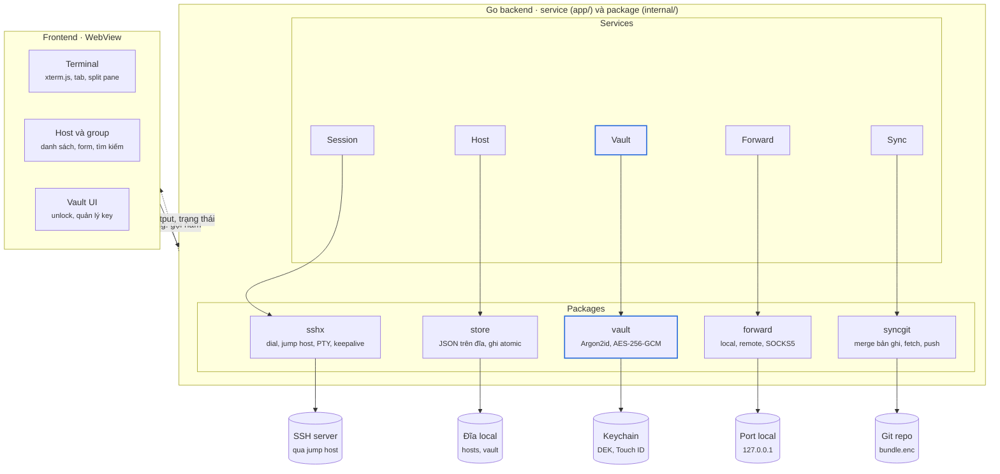
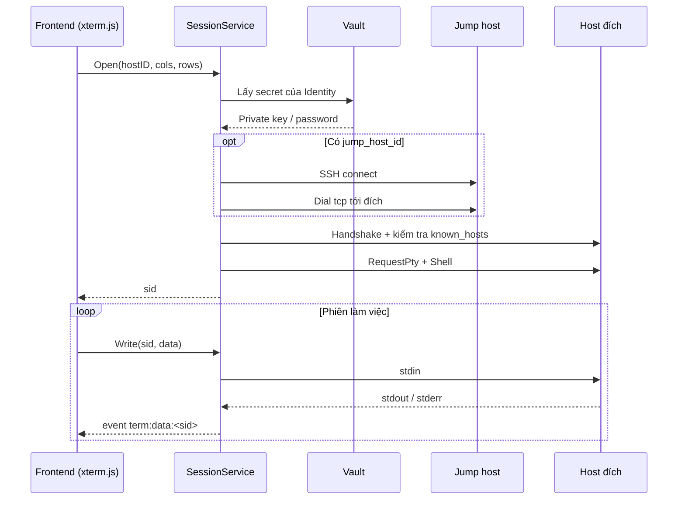
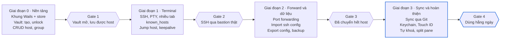

# VVTerm — Tài liệu thiết kế kiến trúc

> Cập nhật: 2026-10-28 · Tác giả: Vũ Nguyễn Vũ

> **Implementation note (English, 2026-10-28).** This is the original design, kept as written. The implementation deviates in a few places; the decisions are recorded in [CleanArchitecture.md](CleanArchitecture.md) (ADR-0001 SQLite instead of JSON files, ADR-0002 clean architecture and package layout, ADR-0003 own `ssh_config` parser) and the full comparison is in [Assessment.md](Assessment.md). Open questions: frontend = React + TypeScript; SFTP and team sharing stay out of scope.

## Mục lục

1. [Tổng quan](#1-tổng-quan)
2. [Lựa chọn công nghệ](#2-lựa-chọn-công-nghệ)
3. [Kiến trúc tổng thể](#3-kiến-trúc-tổng-thể)
4. [Mô hình dữ liệu](#4-mô-hình-dữ-liệu)
5. [Bảo mật và Vault](#5-bảo-mật-và-vault)
6. [Luồng SSH](#6-luồng-ssh)
7. [Import/Export và Sync](#7-importexport-và-sync)
8. [Cấu trúc dự án và API binding](#8-cấu-trúc-dự-án-và-api-binding)
9. [Lộ trình, rủi ro và câu hỏi mở](#9-lộ-trình-rủi-ro-và-câu-hỏi-mở)

---

## 1. Tổng quan

VVTerm là SSH client desktop, dữ liệu do người dùng tự kiểm soát và luôn export được. Host và key không bao giờ bị khoá trong app: mọi thứ xuất ra được dạng chuẩn, sync qua kho Git của chính người dùng.

**Mục tiêu**

- Quản lý host theo group, tag và màu môi trường (dev, staging, production).
- Vault lưu private key và mật khẩu, mã hoá bằng master password.
- Terminal nhiều tab, split pane, jump host, port forwarding.
- Import/export `~/.ssh/config` và file JSON mã hoá — không bao giờ khoá dữ liệu.
- Sync giữa các máy qua Git repo private do người dùng sở hữu.

**Ngoài phạm vi MVP**

- SFTP browser, snippet lệnh, lịch sử phiên, mobile app.
- Chia sẻ host theo team và phân quyền.
- Telnet, serial, RDP, VNC.

Nền tảng ưu tiên: macOS; Windows và Linux build được nhưng không kiểm thử kỹ ở MVP.

---

## 2. Lựa chọn công nghệ

Chọn **Wails v2 + Go** cho backend và **xterm.js** cho terminal: tận dụng Go đang dùng, thư viện SSH chuẩn, binary nhẹ hơn Electron vì dùng WebView của hệ điều hành.

| Tiêu chí | Wails + Go | Electron + Node | Tauri + Rust |
| --- | --- | --- | --- |
| Thư viện SSH | golang.org/x/crypto/ssh | ssh2 | russh |
| WebView | WKWebView (macOS) | Chromium đóng gói | WKWebView (macOS) |
| Độ nặng app | Nhẹ | Nặng nhất | Nhẹ nhất |
| Phù hợp team | Cao (đã dùng Go) | Trung bình | Thấp (phải học Rust) |
| Tham khảo sẵn | Ít | Tabby, Electerm | Ít |

**Thành phần chính**

- Frontend: Svelte hoặc React + TypeScript, xterm.js và addon `fit`, `search`, `web-links`.
- SSH: `golang.org/x/crypto/ssh`, `golang.org/x/crypto/ssh/agent`, `golang.org/x/crypto/ssh/knownhosts`.
- Mã hoá: `golang.org/x/crypto/argon2`, `crypto/aes` + `crypto/cipher` (GCM).
- Keychain: `github.com/zalando/go-keyring` (macOS Keychain, Windows Credential Manager, Secret Service trên Linux).
- Parse ssh config: `github.com/kevinburke/ssh_config`.
- Git sync: gọi `git` CLI có sẵn trên máy, hoặc `github.com/go-git/go-git/v5` nếu muốn không phụ thuộc.
- Lưu trữ: file JSON trên đĩa, chưa cần SQLite ở MVP.

Rủi ro của Wails: WebView khác nhau giữa các OS có thể khiến xterm.js render khác nhau; cần test font và hiệu năng khi output lớn (ví dụ `tail -f` log).

---

## 3. Kiến trúc tổng thể

Ứng dụng gồm ba tầng: frontend trong WebView chỉ hiển thị, Go backend giữ toàn bộ kết nối và secret, và các thành phần bên ngoài app.



Session và Sync cũng gọi Vault để lấy secret hoặc DEK ngay trong Go; frontend chỉ nhận metadata, output terminal và trạng thái. Vault là nơi duy nhất giữ secret đã giải mã.

---

## 4. Mô hình dữ liệu

Dữ liệu tách làm hai phần: cấu hình không bí mật (host, group) lưu dạng JSON thường, còn secret (key, password) nằm trong vault mã hoá. Host chỉ tham chiếu tới Identity bằng ID, không bao giờ chứa secret.

| Entity | Trường chính | Lưu ở |
| --- | --- | --- |
| Group | id, name, parent_id, color, sort_order | `hosts.json` |
| Host | id, label, group_id, hostname, port, username, identity_id, jump_host_id, env (dev/staging/prod), tags[], keepalive_sec, created_at, updated_at | `hosts.json` |
| PortForward | id, host_id, type (local/remote/dynamic), bind_addr, bind_port, dest_host, dest_port, auto_start | `hosts.json` |
| Identity | id, name, username, auth_type (key/password/agent), secret_ref | `hosts.json` (metadata) |
| Secret | id, kind (private_key/password/passphrase), ciphertext, nonce | `vault.json` |
| KnownHost | hostname:port, key_type, fingerprint | `known_hosts` (định dạng OpenSSH) |

**Cấu trúc thư mục dữ liệu** (macOS: `~/Library/Application Support/vvterm/`)

```
data/
  hosts.json        # group, host, port forward, identity metadata
  vault.json        # secret đã mã hoá + header KDF
  known_hosts       # định dạng OpenSSH
  settings.json     # theme, font, phím tắt (không sync)
sync/               # Git working copy, chỉ chứa file đã mã hoá
```

Mỗi bản ghi có `id` dạng UUID v7 và `updated_at` để phục vụ merge khi sync. Xoá dùng tombstone (`deleted_at`) thay vì xoá cứng, để máy khác biết bản ghi đã bị xoá.

---

## 5. Bảo mật và Vault

Vault dùng envelope encryption: một data key (DEK) ngẫu nhiên mã hoá mọi secret, còn master password chỉ dùng để bọc DEK. Đổi master password chỉ cần bọc lại DEK, không phải mã hoá lại toàn bộ secret.

**Luồng mã hoá**

1. Khi tạo vault: sinh `salt` 16 byte và DEK 32 byte bằng `crypto/rand`.
2. KEK = Argon2id(master password, salt), tham số đề xuất m = 64 MiB, t = 3, p = 4, độ dài 32 byte. Tham số lưu trong header để nâng sau này.
3. DEK được bọc bằng AES-256-GCM với KEK, lưu `wrapped_dek` + `nonce` trong header `vault.json`.
4. Mỗi secret mã hoá riêng bằng AES-256-GCM với DEK, nonce 12 byte ngẫu nhiên; `secret.id` dùng làm AAD để chống hoán đổi ciphertext giữa các bản ghi.

**Mở khoá nhanh**

- Tuỳ chọn lưu DEK vào macOS Keychain, yêu cầu Touch ID hoặc mật khẩu máy để đọc.
- Tự khoá vault sau N phút không hoạt động và khi máy sleep; xoá DEK khỏi bộ nhớ khi khoá.

**Xác thực host**

- Kiểm tra host key bằng `knownhosts.New`; host mới thì hiển thị fingerprint SHA256 cho người dùng xác nhận.
- Host key thay đổi thì chặn kết nối và cảnh báo, không có nút "bỏ qua" mặc định.
- Tuyệt đối không dùng `ssh.InsecureIgnoreHostKey()`.

**Threat model**

| Mối đe doạ | Biện pháp |
| --- | --- |
| Lộ repo sync hoặc file backup | Secret đã mã hoá; `hosts.json` khi sync cũng mã hoá để không lộ IP nội bộ |
| Brute-force master password | Argon2id tham số cao; yêu cầu độ dài tối thiểu |
| MITM khi kết nối | Kiểm tra known_hosts nghiêm ngặt |
| Frontend bị XSS (ví dụ output terminal độc) | Frontend không bao giờ nhận secret; Go giữ secret, chỉ trả về metadata; CSP chặt |
| Máy bị chiếm khi vault đang mở | Tự khoá theo thời gian và khi sleep |

Không bảo vệ được: malware đã chạy trên máy với quyền user, có thể đọc bộ nhớ khi vault đang mở.

---

## 6. Luồng SSH

Mỗi tab terminal là một `Session` trong Go, có `sid` riêng; dữ liệu chạy hai chiều qua Wails: output bằng event, input bằng binding. Frontend không bao giờ giữ socket hay secret.

**Kết nối một host**

1. Frontend gọi `SessionService.Open(hostID, cols, rows)` và nhận về `sid`.
2. Go đọc Host, giải mã Identity từ vault, dựng `ssh.ClientConfig` với `HostKeyCallback` từ known_hosts.
3. Nếu có `jump_host_id`: kết nối jump host trước, rồi mở kênh tới đích qua nó (đoạn code bên dưới). Hỗ trợ chuỗi nhiều jump host bằng đệ quy, giới hạn độ sâu để tránh vòng lặp.
4. Mở `session`, `RequestPty("xterm-256color", rows, cols, modes)`, rồi `Shell()`.
5. Goroutine đọc stdout/stderr theo khối, emit event `term:data:<sid>`; frontend `term.write()`.
6. Phím gõ từ xterm.js đi qua `SessionService.Write(sid, data)` vào stdin.
7. Khung cửa sổ thay đổi: addon `fit` tính lại cols/rows, gọi `Resize(sid, cols, rows)` → `session.WindowChange`.
8. Đóng tab hoặc remote thoát: đóng session, client, port forward liên quan; emit `term:closed:<sid>`.



```go
// Kết nối tới đích thông qua jump host
func dialVia(jump *ssh.Client, addr string, cfg *ssh.ClientConfig) (*ssh.Client, error) {
	conn, err := jump.Dial("tcp", addr)
	if err != nil {
		return nil, err
	}
	c, chans, reqs, err := ssh.NewClientConn(conn, addr, cfg)
	if err != nil {
		conn.Close()
		return nil, err
	}
	return ssh.NewClient(c, chans, reqs), nil
}
```

**Port forwarding**

| Loại | Cách làm trong Go | Ví dụ dùng |
| --- | --- | --- |
| Local (-L) | `net.Listen` trên máy, mỗi kết nối gọi `client.Dial` tới đích rồi `io.Copy` hai chiều | Forward MariaDB 3306, Redis 6379 về localhost |
| Remote (-R) | `client.Listen` trên server, mỗi kết nối `net.Dial` về máy local | Cho server gọi webhook về máy dev |
| Dynamic (-D) | SOCKS5 server local, mỗi request gọi `client.Dial` | Duyệt web nội bộ qua bastion |

Mặc định bind `127.0.0.1`, không bind `0.0.0.0` trừ khi người dùng bật rõ ràng.

**Giữ kết nối và kết nối lại**

- Gửi `keepalive@openssh.com` theo `keepalive_sec`; nhiều lần không phản hồi thì coi là mất kết nối.
- Mất kết nối: giữ nguyên nội dung terminal, hiện banner "Nhấn Enter để kết nối lại"; không tự kết nối lại để tránh chạy lại lệnh ngoài ý muốn.
- Port forward có `auto_start` được dựng lại sau khi kết nối lại thành công.

---

## 7. Import/Export và Sync

Mọi dữ liệu phải ra được dạng chuẩn mà không cần app; sync chỉ đẩy file đã mã hoá lên Git repo private của người dùng.

**Import**

| Nguồn | Ánh xạ |
| --- | --- |
| `~/.ssh/config` | `Host` → Host; `HostName`, `Port`, `User`; `IdentityFile` → nhập key vào vault; `ProxyJump` → jump_host_id; `LocalForward`/`RemoteForward`/`DynamicForward` → PortForward; theo dõi `Include` |
| Thư mục key | Chọn file private key, hỏi passphrase nếu có, lưu vào vault |
| File backup JSON mã hoá | Khôi phục toàn bộ, hỏi mật khẩu backup |

Group khi import từ ssh config lấy theo tên file trong `config.d/` (ví dụ `acme-prod` → group `acme-prod`). Host trùng tên thì hỏi ghi đè, bỏ qua hay tạo bản sao.

**Export**

| Định dạng | Nội dung | Ghi chú |
| --- | --- | --- |
| `ssh config` | Host, group (mỗi group một file), jump host, port forward | Key xuất ra file riêng chỉ khi người dùng tick chọn, có cảnh báo, `chmod 600` |
| JSON mã hoá | Toàn bộ dữ liệu kể cả secret | Mật khẩu backup đặt riêng khi export, không phải master password |
| JSON thường | Chỉ metadata, không secret | Dùng để chia sẻ danh sách host |

**Sync qua Git**

Repo chỉ chứa `bundle.enc` (hosts + vault, mã hoá bằng DEK) và `vault-header.json` (salt, tham số Argon2id, wrapped DEK). Máy mới clone repo, nhập master password để mở DEK là có đủ dữ liệu.

1. `git fetch` và đọc `bundle.enc` tại `origin/main`.
2. Giải mã, merge với dữ liệu local theo từng bản ghi.
3. Mã hoá lại, commit trên đỉnh `origin/main`, `git push`.
4. Push bị từ chối vì máy khác vừa đẩy: quay lại bước 1, tối đa vài lần rồi báo lỗi.

**Xử lý xung đột**

Ciphertext không merge được bằng Git, nên app tự merge ở mức bản ghi:

- Bản ghi chỉ có ở một phía → giữ.
- Có ở cả hai phía → lấy bản có `updated_at` mới hơn (last-write-wins).
- Tombstone mới hơn bản sửa → xoá; bản sửa mới hơn tombstone → khôi phục.
- Đồng hồ máy lệch có thể làm sai thứ tự; chấp nhận ở MVP vì một người dùng hiếm khi sửa cùng host trên hai máy cùng lúc.

`settings.json` và `known_hosts` không sync ở MVP.

---

## 8. Cấu trúc dự án và API binding

Code Go chia theo service, mỗi service là một struct được Wails bind sang frontend; logic nằm trong `internal/`, không phụ thuộc Wails để test được bằng `go test`.

```
vvterm/
  main.go                 # khởi tạo Wails, đăng ký service
  app/                    # adapter mỏng: service bind sang frontend
    host_service.go
    vault_service.go
    session_service.go
    forward_service.go
    sync_service.go
  internal/
    model/                # Host, Group, Identity, PortForward, Secret
    store/                # đọc/ghi JSON, ghi file atomic (tmp + rename)
    vault/                # Argon2id, AES-GCM, keychain
    sshx/                 # dial, jump host, pty, keepalive, known_hosts
    forward/              # local, remote, SOCKS5
    importer/             # ssh config, backup
    exporter/
    syncgit/              # fetch, merge bản ghi, push
  frontend/
    src/
      lib/terminal/       # xterm.js wrapper, tab, split pane
      lib/hosts/          # danh sách, group, form
      lib/vault/          # màn hình unlock, quản lý key
      wailsjs/            # binding sinh tự động
```

**API binding**

| Service | Phương thức | Ghi chú |
| --- | --- | --- |
| VaultService | `Status()`, `Create(pw)`, `Unlock(pw)`, `UnlockBiometric()`, `Lock()`, `ChangePassword(old, new)` | Không phương thức nào trả secret về frontend |
| VaultService | `ListIdentities()`, `AddKey(name, path, passphrase)`, `AddPassword(name, user, pw)`, `GenerateKey(name, type)`, `PublicKey(id)` | `GenerateKey` sinh ed25519, chỉ trả public key để copy |
| HostService | `ListGroups()`, `SaveGroup(g)`, `DeleteGroup(id)`, `ListHosts(filter)`, `SaveHost(h)`, `DeleteHost(id)` | Xoá = tombstone |
| SessionService | `Open(hostID, cols, rows) → sid`, `Write(sid, data)`, `Resize(sid, cols, rows)`, `Close(sid)` | Output qua event `term:data:<sid>` |
| SessionService | `TrustHostKey(sid, fingerprint)` | Trả lời khi có event `term:hostkey:<sid>` |
| ForwardService | `Start(forwardID)`, `Stop(forwardID)`, `List()` | Trạng thái qua event `forward:state` |
| SyncService | `Configure(repoURL)`, `SyncNow()`, `Status()` | Git auth dùng SSH agent hoặc credential helper có sẵn |
| ImportExportService | `ImportSSHConfig(path)`, `ExportSSHConfig(dir, withKeys)`, `ExportBackup(path, pw)`, `ImportBackup(path, pw)` | |

**Event từ Go sang frontend**

- `term:data:<sid>` — output, gộp theo khối ~16 ms để không ngập event khi output lớn.
- `term:hostkey:<sid>` — cần xác nhận fingerprint.
- `term:closed:<sid>` — phiên kết thúc, kèm lý do.
- `vault:locked` — vault tự khoá, frontend chuyển về màn hình unlock.

---

## 9. Lộ trình, rủi ro và câu hỏi mở

Triển khai theo bốn giai đoạn; chỉ sang giai đoạn sau khi qua gate của giai đoạn trước. Chưa ước lượng thời gian cho từng giai đoạn.



Sau Gate 2 đã dùng được hằng ngày cho SSH cơ bản; Gate 4 là lúc VVTerm đủ tính năng để làm công cụ SSH chính.

**Rủi ro**

| Rủi ro | Ảnh hưởng | Xử lý |
| --- | --- | --- |
| xterm.js trên WKWebView chậm khi output lớn | Lag khi `tail -f` log | Gộp event theo khối, đo hiệu năng ngay ở giai đoạn 1 |
| Key cũ (RSA SHA-1, DSA) không tương thích `x/crypto/ssh` | Không vào được server cũ | Hỗ trợ `rsa-sha2-256/512`; báo rõ khi key không hỗ trợ |
| Quên master password | Mất toàn bộ vault | Cảnh báo khi tạo vault; nhắc export backup định kỳ |
| Lệch đồng hồ giữa các máy khi sync | Ghi đè nhầm bản sửa | Chấp nhận ở MVP; sau có thể dùng version vector |

**Câu hỏi mở**

- [x] Tên app: **VVTerm** (repo `vvterm`, CLI `vvt`)
- [ ] Frontend dùng Svelte hay React?
- [ ] Có đưa SFTP vào sớm hơn giai đoạn 3 không?
- [ ] Chỉ dùng cá nhân hay sẽ chia sẻ host cho team?