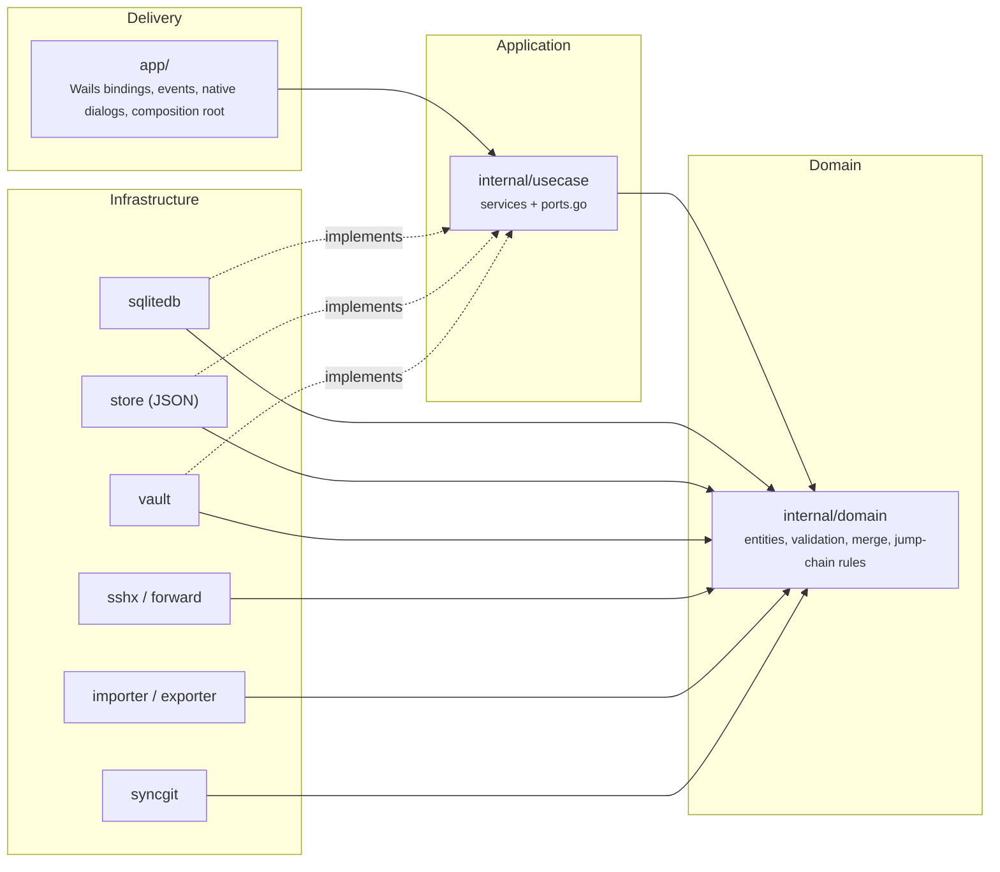

# Clean architecture

## Layers and the dependency rule

Source-level dependencies point inward only. A test (`internal/archtest`) fails the build if the rule is broken.

| Layer | Package(s) | May import | Must not import |
| --- | --- | --- | --- |
| Domain | `internal/domain` | standard library | any project package, Wails, `x/crypto/ssh` |
| Application | `internal/usecase` | domain, ports it declares, `fsutil`, the infrastructure libraries listed below | Wails, `app`, `store` |
| Infrastructure | `sqlitedb`, `store`, `vault`, `sshx`, `forward`, `importer`, `exporter`, `syncgit`, `fsutil`, `testssh` | domain, each other | `usecase`, `app`, Wails |
| Delivery / composition root | `app` | everything | — |

### What lives where

- **Domain** (`internal/domain`): `Host`, `Group`, `Identity`, `PortForward`, `Secret`, the vault header and status types, and rules that do not need I/O: `NormalizeHost` (including rejecting control characters that could inject ssh config directives), `NormalizeForward` (loopback by default), `CheckJumpChain` (loops, depth limit), `IsLoopback`, and the record-level `Merge` (last-write-wins with tombstones).
- **Ports** (`internal/usecase/ports.go`): `Repository` (hosts, groups, identities, forwards), `SecretVault` (encryption, unlock, secrets, sync helpers) and `Emitter` (events to the UI).
- **Adapters**: `sqlitedb` provides the persisters used in production; `store` and `vault` contain the in-memory models/crypto and accept any `Persister` (SQLite, JSON file, test double).
- **Composition root**: `app.Build` is the only place that constructs concrete adapters and wires them into the use cases.

### Using a different storage engine

Implement `store.Persister` and `vault.Persister`, then pass them to `store.OpenWith` / `vault.NewWith` in `app.Build`. Use cases and the UI do not change. The same use-case test suite runs on SQLite today (`internal/usecase/harness_test.go`).

## Known technical debt (visible and bounded)

`internal/usecase` still imports these infrastructure packages directly instead of through ports:

| Package | Why | Planned port |
| --- | --- | --- |
| `sshx` | SSH dialing, PTY shell, keepalive | `Connector` returning a `Connection` with `OpenShell`, `Dial`, `Listen` |
| `forward` | forwarding engine uses the SSH connection | folds into `Connector` |
| `importer`, `exporter` | ssh config parsing/writing, backup envelope | `ConfigCodec` |
| `syncgit` | git CLI transport | `SyncTransport` |
| `vault` | key parsing helpers (`ParsePrivateKey`, `GenerateEd25519`), keychain types | move key helpers behind `SecretVault`/`KeyTools` |

`internal/archtest` holds this list as an allow-list: it may shrink but adding a new infrastructure import to `usecase` fails the test.

---

# Architecture decision records

## ADR-0001: Use SQLite for local persistence

- **Status**: accepted (supersedes "JSON files, no SQLite in the MVP" in `Architecture.md` §2/§4).
- **Context**: The product requirement is that the app uses SQLite. Data is small, single-user, and must survive crashes.
- **Decision**: One database file, `data/vvterm.db`, via the pure-Go driver `modernc.org/sqlite` (no extra CGO toolchain). Tables: `groups`, `hosts`, `identities`, `port_forwards`, `secrets`, `vault_header`. Schema versioned with `PRAGMA user_version`; a database newer than the app is refused. WAL mode, one connection, every save is a single transaction.
- **Consequences**: atomicity comes from transactions instead of tmp+rename; records keep `updated_at`/`deleted_at` columns for sync; secrets remain AES-GCM ciphertext in `secrets`, verified by a test that greps the database and WAL for plaintext. Whole-set saves are O(n), which is fine at this scale; if data grows, switch to per-record upserts behind the same `Persister`. `known_hosts` stays an OpenSSH text file and `settings.json` stays JSON on purpose (tools and users edit them).

## ADR-0002: Clean architecture with ports and an enforced dependency rule

- **Status**: accepted.
- **Context**: Business rules (validation, merge, jump-host safety) and orchestration were mixed with storage and UI wiring, which made them hard to test and to change.
- **Decision**: Four layers as above. Rules moved into `domain`; orchestration moved from `app/` into `internal/usecase` behind `Repository`, `SecretVault` and `Emitter`; `app/` kept only Wails glue and the composition root. `internal/archtest` parses imports and fails on violations.
- **Consequences**: the use-case tests run without Wails; storage is swappable. The remaining direct infrastructure imports are documented debt (table above).

## ADR-0003: Own `ssh_config` parser

- **Status**: accepted (deviates from `Architecture.md` §2, which suggested `kevinburke/ssh_config`).
- **Context**: Import must derive the group from the file name of each `Include`d file and keep a `# vvterm:` metadata comment for round-trips; the library does not expose the source file of a block.
- **Decision**: Small purpose-built parser (`internal/importer`) covering `Host`, `HostName`, `Port`, `User`, `IdentityFile`, `ProxyJump`, `Local/Remote/DynamicForward`, `Include` (with loop and depth protection). Unsupported directives such as `ProxyCommand` produce warnings.
- **Consequences**: fewer directives than OpenSSH supports (no `Match`, no token expansion); round-trip export → import is covered by tests.

## ADR-0004: Output is buffered until the frontend attaches

- **Status**: accepted.
- **Context**: `Open` returns a session id after the backend has already started connecting. Events emitted before the UI subscribed (host key prompt, banner) would be lost, especially for fast local hosts.
- **Decision**: `Open` starts the connection; `Attach(sid)` marks the UI as listening. Until then output is buffered (1 MiB cap) and state (pending host key prompt, ready, closed) is replayed on `Attach`.
- **Consequences**: no lost first output; one extra binding call per session.

## ADR-0005: No automatic reconnect

- **Status**: accepted (from `Architecture.md` §6).
- **Decision**: a dropped link keeps the terminal content and shows a banner; the user presses Enter to reconnect. Forwards flagged `auto_start` are rebuilt after a successful reconnect.
- **Rationale**: avoids replaying commands or duplicating side effects without the user noticing.
