

# VVTerm user guide

Every screenshot here comes from the automated end-to-end walkthrough (`make e2e`) running against the real application, so they match the current interface.

## Contents

1. [Create and unlock the vault](#1-create-and-unlock-the-vault)
2. [The main window](#2-the-main-window)
3. [Keychain: keys and passwords](#3-keychain-keys-and-passwords)
4. [Add a host: test, save, connect](#4-add-a-host-test-save-connect)
5. [Hosts and groups](#5-hosts-and-groups)
6. [Connect](#6-connect)
7. [Snippets](#7-snippets)
8. [Split panes and search](#8-split-panes-and-search)
9. [SFTP: browse and transfer files](#9-sftp-browse-and-transfer-files)
10. [Port forwarding](#10-port-forwarding)
11. [Import and export](#11-import-and-export)
12. [Settings](#12-settings)
13. [Sync between Macs](#13-sync-between-macs)
14. [Forgot your master password](#14-forgot-your-master-password)
15. [When something goes wrong](#15-when-something-goes-wrong)
16. [Where your data lives](#16-where-your-data-lives)

## 1. Create and unlock the vault

On first launch choose a master password (at least 12 characters). It protects your keys and passwords and **cannot be recovered** (see [section 13](#13-forgot-your-master-password) for what you can do if you lose it).

Next time, or after auto-lock, enter it to unlock. A wrong password never unlocks anything.

## 2. The main window

- **Title bar:** the **Vaults** tab is home; every terminal you open becomes a tab. **+** returns home to find a host. At the right: the **Settings** gear, **Snippets** and the split buttons (active inside a terminal). Drag the bar to move the window.
- **Navigation:** Hosts, Keychain, Port Forwarding, Snippets; at the bottom Import / Export, Settings and Lock vault. In a narrow window the navigation shrinks to icons.

## 3. Keychain: keys and passwords

**Keychain** holds identities. Pick a tab:

- **Generate key**: creates an ed25519 key pair. Only the public key is shown. Copy it into `~/.ssh/authorized_keys` on your servers.
- **Import key**: from a file or pasted text; give the passphrase if the key is encrypted.
- **Add password** or **ssh-agent** identity.

Private keys and passwords never leave the vault: the interface only shows names and public keys. A password you type in the host form is saved here automatically as an identity.

## 4. Add a host: test, save, connect

**New host** opens a form **docked next to the host list** (no popup), with a draft card showing what you are typing. If you move to another screen the form closes.

The form follows one flow, top to bottom:

1. **Address** (IP or hostname).
2. **General**: label, parent group, environment colour, tags.
3. **SSH on … port**.
4. **Credentials**: username and password, or choose a saved key/identity. The eye shows or hides the password.
5. **Options**: host chaining (jump host) and keepalive.

Dropdowns open a custom menu with hints and keyboard support (arrows, Enter, Esc, type to jump):

At the bottom:

- **Test connection** checks what you typed (including the jump host) **without saving anything**. For an unknown server you confirm its fingerprint right in the form.
- **Save** stores the host.
- **Connect** saves it and opens a terminal.

A failed test explains why (wrong password, host unreachable, key not trusted) and never shows the password.

## 5. Hosts and groups

Groups appear as cards with their host count. Click one to open it (a breadcrumb takes you back).

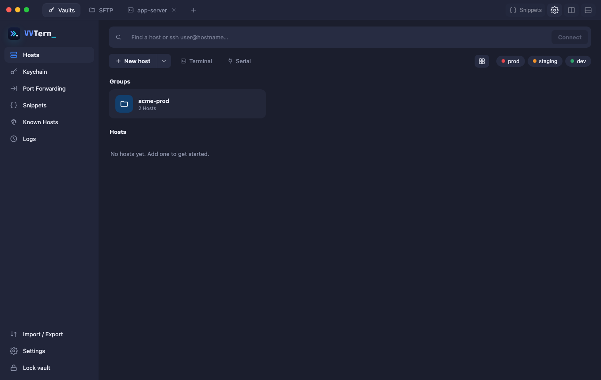

**Search** matches label, hostname, user and tags across all groups; the environment chips filter further.

**Quick connect:** type `ssh user@host:port` and press Enter. If it matches a saved host you connect; otherwise *New host* opens pre-filled so you can save it.

## 6. Connect

Double-click a host card (or press ▶), or use **Connect** in the New host form. The first time, VVTerm shows the server fingerprint. Verify it out of band, then choose **Trust and connect**. With a jump host you confirm each machine once.

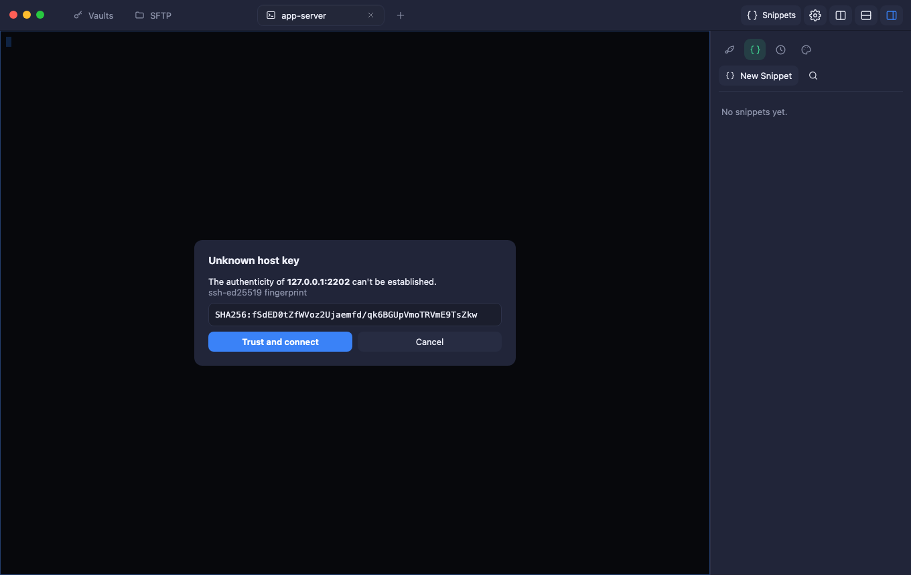

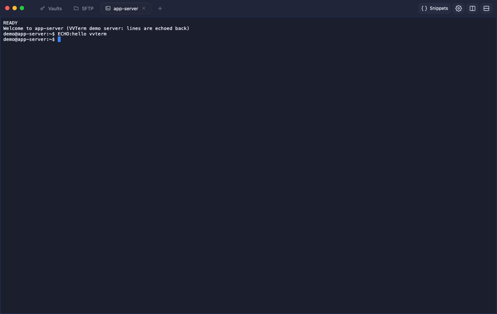

Trusted keys go to `known_hosts` (OpenSSH format) and are not asked again.

## 7. Snippets

Snippets are commands you reuse. **Snippets → New snippet**: a label, an optional description and the script (one or more lines).

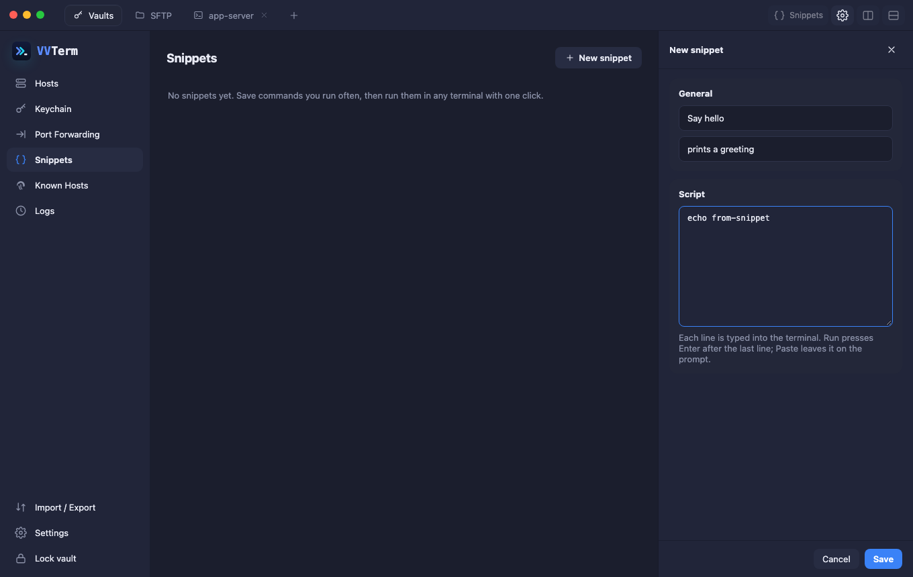

- **Run** (▶) types the script and presses Enter in the focused pane of your terminal and switches to it.
- **Paste** types it *without* Enter, so you can read or edit it first.
- Inside a terminal, the **Snippets** menu in the title bar does the same without going back home.

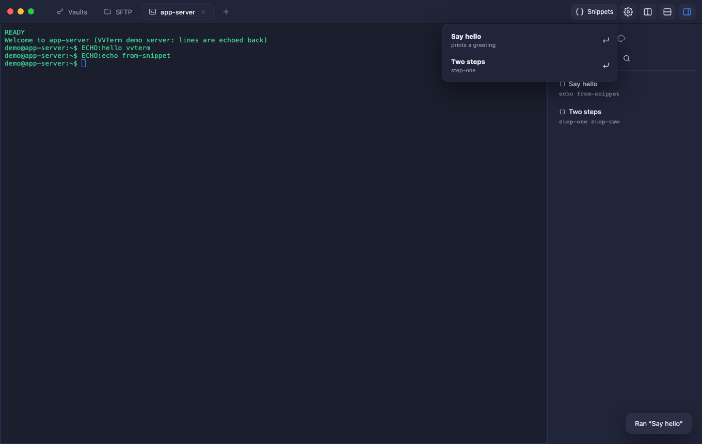

A terminal must be open and connected. Snippets sync with Git and are included in backups.

## 8. Split panes and search

Use the two buttons at the top right to split the focused pane right or down. Every pane is its own session to the same host. **Ctrl/Cmd+F** searches the scrollback. When a shell exits (`exit`) its pane closes; closing the last pane closes the tab.

## 9. SFTP: browse and transfer files

Use the **folder button** on a host card to open a file browser in its own tab (the tab has a folder icon). VVTerm opens a separate SSH connection, through the jump hosts if the host has any, so you do not need an open terminal. The first time you connect to an unknown server you are asked to trust its key, exactly as for a terminal.

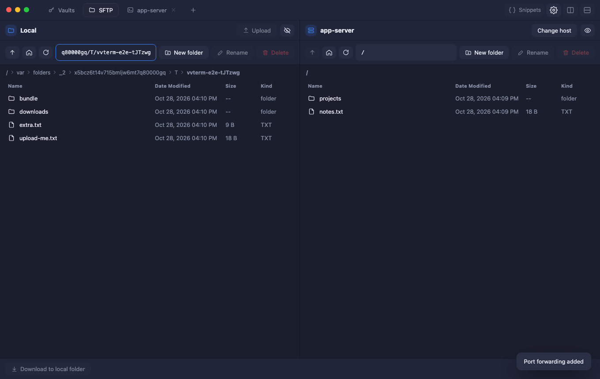

- **Browse:** double-click a folder (or press Enter), use the arrows, breadcrumbs, *Up*, *Home*, *Refresh* or type a path in the box.
- **Upload** a file into the current folder, **Download** the selected file, **New folder**, **Rename**, **Delete** (folders are deleted with everything inside, after a confirmation).
- Nothing is overwritten silently: if the target already exists, on either side, you are asked whether to replace it. Transfers go through a temporary file and are renamed when complete, so an interrupted transfer never leaves half a file behind.
- A progress bar shows each transfer.

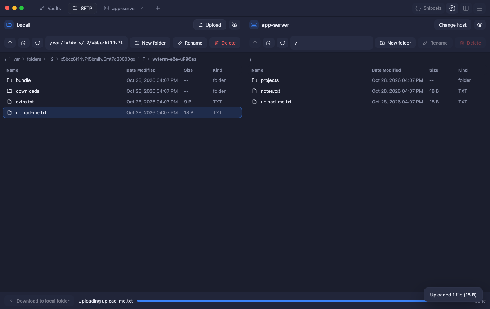

- If the connection drops, a banner offers **Reconnect**.
- **Limits:** files only (no folder upload/download yet, no transfer queue or resume), and no drag and drop from Finder. Closing an SFTP tab asks first (see *Confirm before closing a tab*).

## 10. Port forwarding

Open **Port Forwarding**, pick *New forward for host…*, and add one:

| Type | Meaning |
| --- | --- |
| Local (-L) | listen on your Mac, connect to a destination through the host |
| Remote (-R) | listen on the server, connect back to a destination on your Mac |
| Dynamic (-D) | local SOCKS5 proxy through the host |

Forwards listen on `127.0.0.1`; other addresses need an explicit checkbox. *Start automatically* brings the forward up with the terminal.

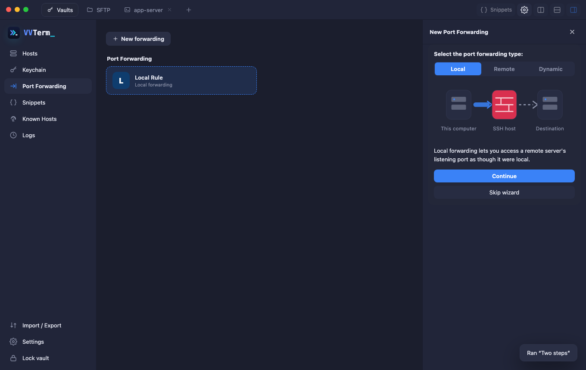

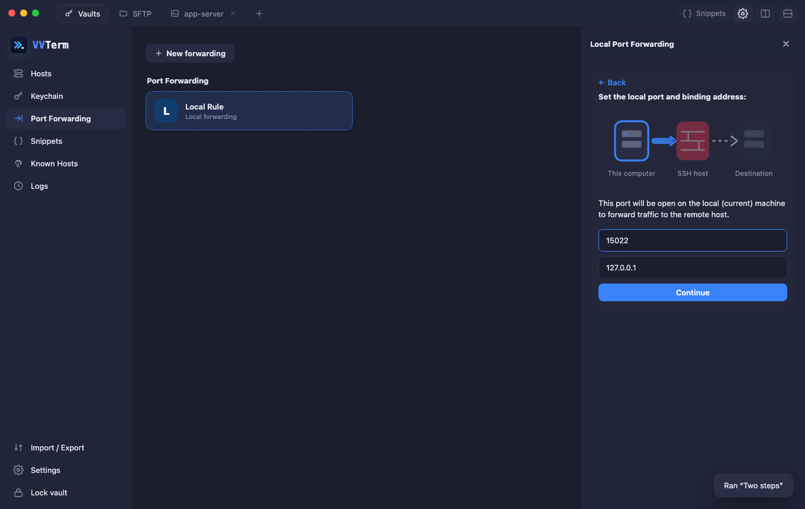

The page lists every forward with its host and state.

## 11. Import and export

**Import / Export** in the navigation.

- **Import `~/.ssh/config`**: follows `Include`; the file name inside `config.d/` becomes the group; `ProxyJump` becomes a jump host; forwards and `IdentityFile` keys come along (vault must be unlocked). Choose what to do when a name already exists: skip, overwrite or create a copy.
- **Export ssh config**: one file per group; private keys only if you tick the checkbox (a warning is shown, files get mode `0600`).
- **Export host list (JSON)**: no secrets, safe to share.
- **Encrypted backup**: everything, protected by a *separate* password (8+ characters).

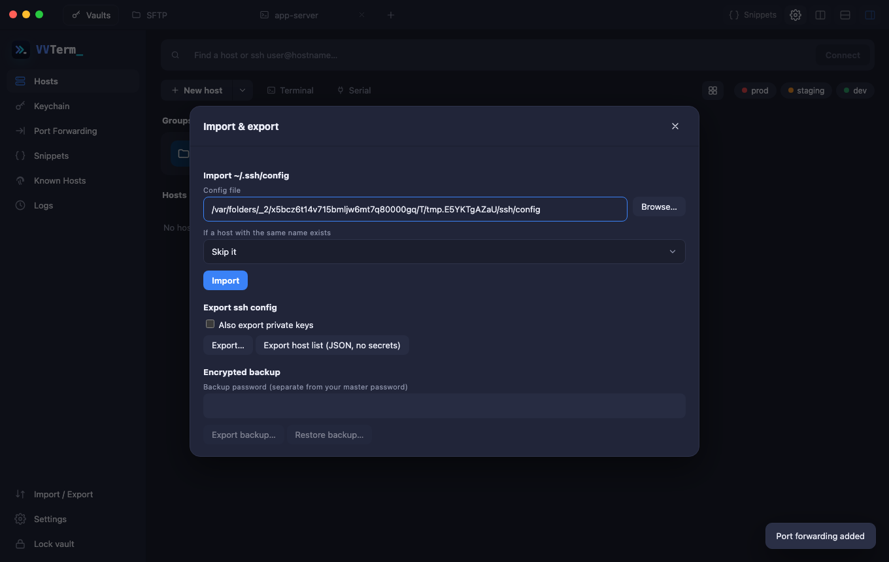

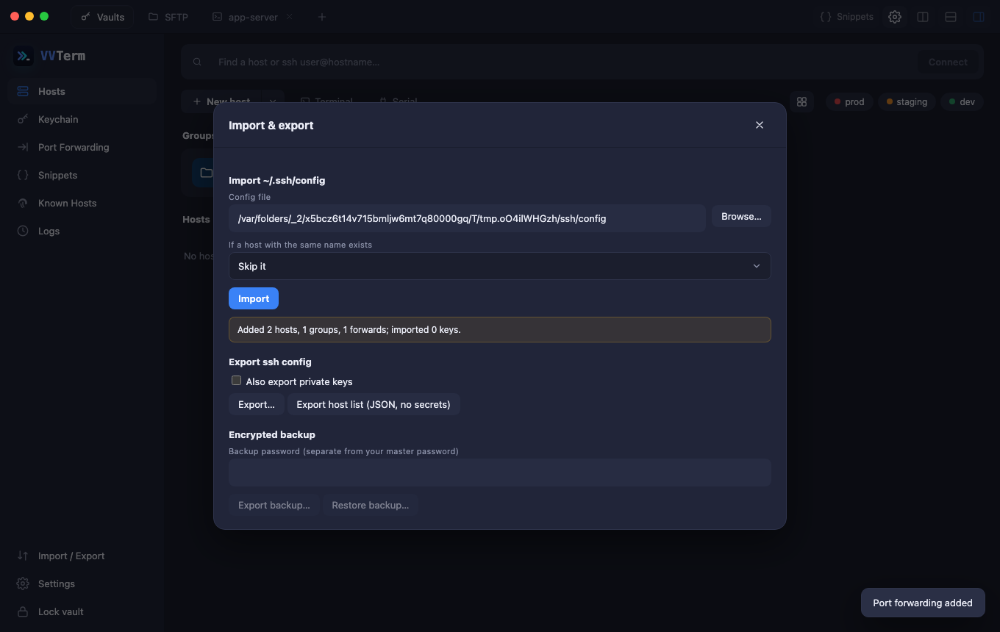

Anything unsupported (for example `ProxyCommand`) is listed as a warning instead of being dropped silently.

## 12. Settings

Open **Settings** from the navigation, the gear in the title bar, or **⌘/Ctrl + ,** (it works from a terminal tab too). It opens as **a window of its own** (with the usual red, yellow and green buttons): move it anywhere, resize it, or use the green button for macOS full screen. Opening it again brings the existing window to the front, and it closes when you quit VVTerm. (Screenshots below show the same content in the in-app variant that the test run uses.)

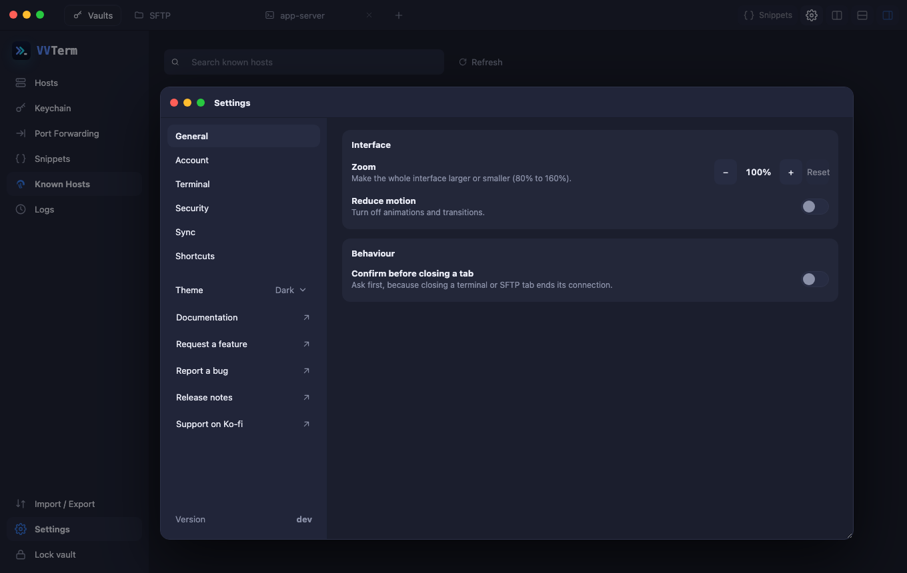

The menu on the left has **General, Account, Terminal, Security, Sync, Shortcuts**, then **Theme**, help links (documentation, feature requests, bug reports, release notes, Ko-fi) and the **version**. Changes apply immediately.

- **General:** **Zoom** makes the whole interface larger or smaller (80 % to 160 %, also with the zoom shortcuts), **Reduce motion** turns animations off, and **Confirm before closing a tab** asks before ending a terminal or SFTP connection.
- **Account:** a local profile (display name and email, stored only in your settings file), your plan, and a disabled **Sign in** for the cloud features planned for later. Nothing is sent anywhere.

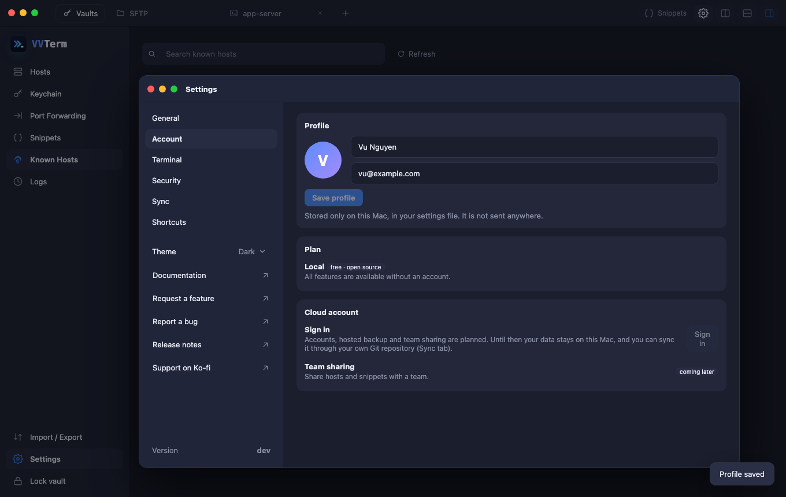

- **Shortcuts:** every action has a default, shown as a key chip. Click a chip, press the new combination and it is saved. A combination already in use is refused and tells you which action owns it; plain keys are refused (add Ctrl, Alt or ⌘; F-keys are allowed). *Reset* returns one action to its default, *Reset all* all of them. Esc and a few terminal keys are fixed and listed below the table.

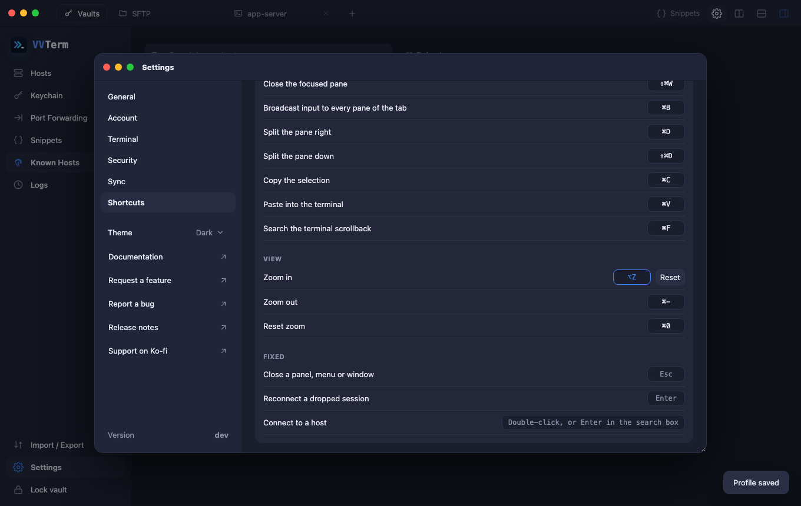

- **Terminal theme:** 26 colour themes with live swatches (Dracula, Nord, Tokyo Night, Solarized, Gruvbox, Kanagawa, Rosé Pine…), filterable by dark/light, or *Match app theme*. A preview shows your font, size, cursor and colours.
- **Font, size, cursor** (block, bar, underline), blinking, **scrollback**.

- **Theme (sidebar):** *Auto* follows your Mac's light/dark mode, or force *Light* or *Dark*.

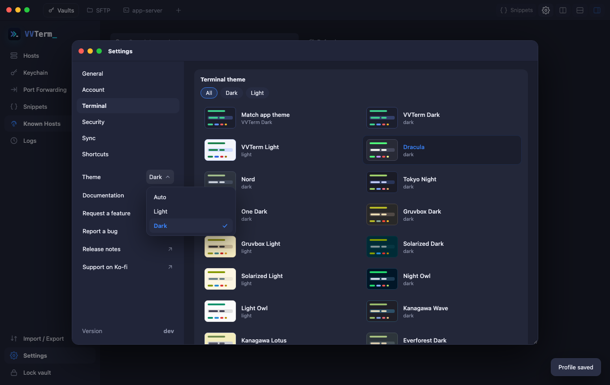

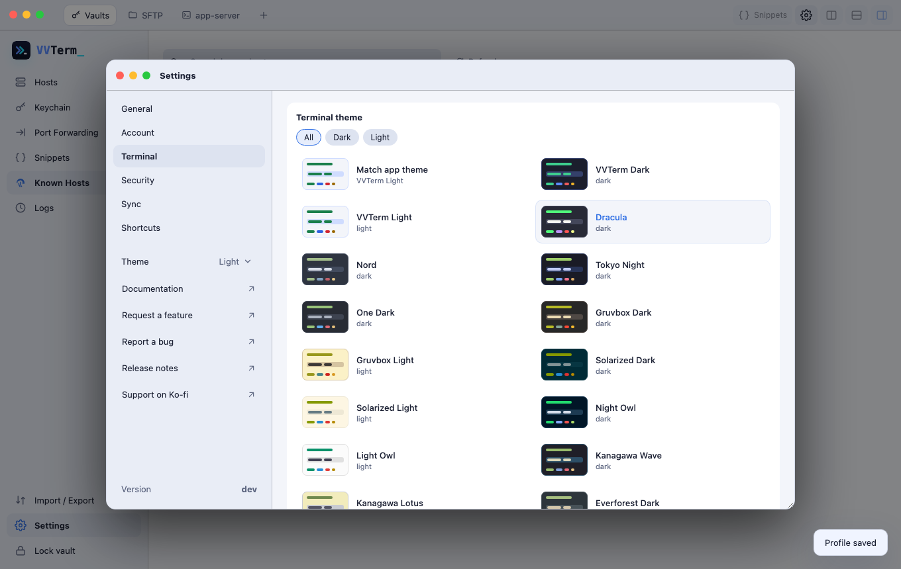

- **Security:** auto-lock after N idle minutes (default 15; the key is wiped from memory), unlock with the macOS Keychain (anyone who can unlock your Keychain can then open the vault), change the master password.

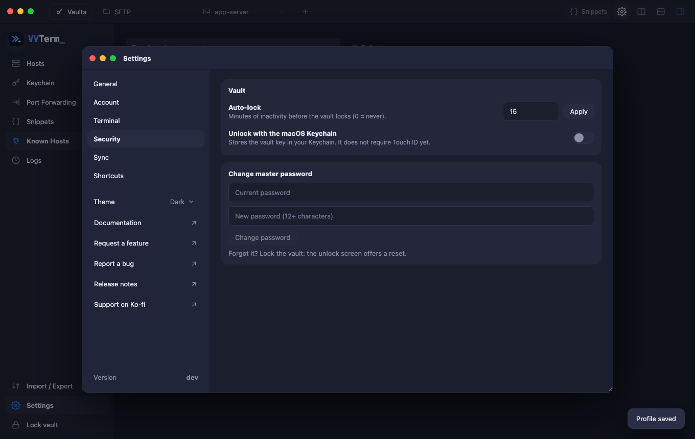

## 13. Sync between Macs

Open **Settings → Sync**.

1. Create an empty **private** Git repository and make sure `git` can push to it (ssh-agent or a credential helper).
2. **Repository URL → Save repository → Sync now.**
3. On a new Mac open **Settings → Sync**, enter the URL, and choose **Restore from repository** with the master password of the synced vault (only before a local vault exists).

The repository only holds `bundle.enc` and `vault-header.json`, both encrypted: hostnames and IPs are not visible. Conflicts are merged per record (newest edit wins; a newer edit beats an older delete and the reverse).

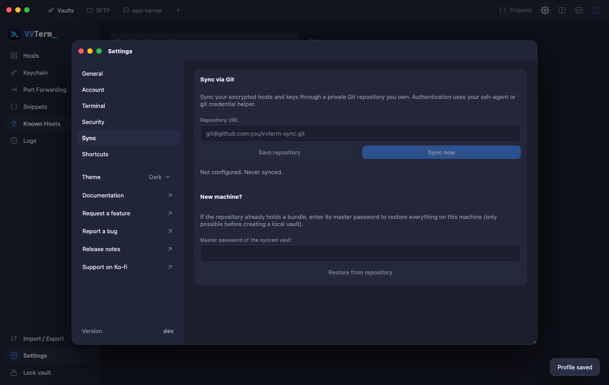

## 14. Forgot your master password

**It cannot be recovered.** The password never leaves your Mac, so nobody can reset it for you. On the unlock screen choose **Forgot password?**:

You can **reset the vault**. Type `RESET` to confirm. This permanently erases every saved key and password, and **keeps** your hosts, groups, snippets and port forwards. Hosts that used a saved credential need new ones. Then create a new master password:

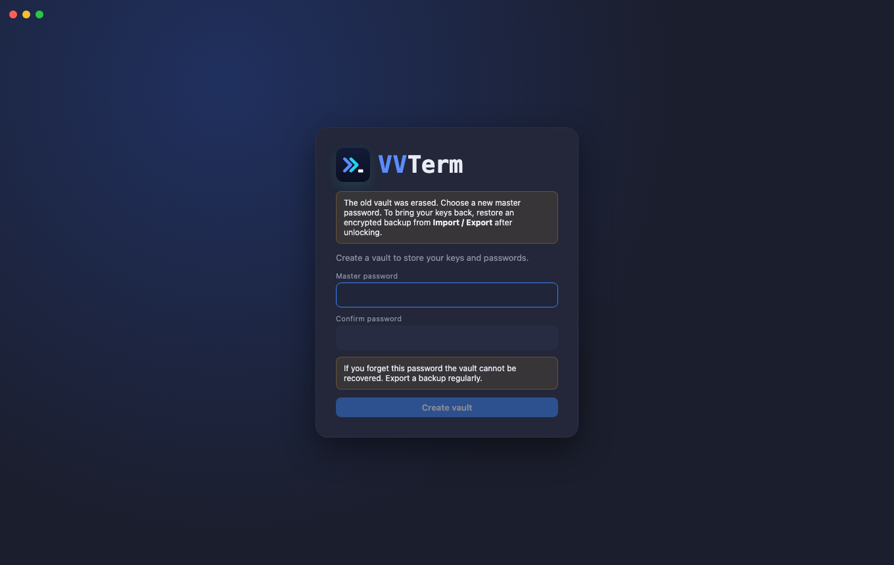

If you have an **encrypted backup**, restore it from **Import / Export** after unlocking the new vault to bring your keys back. If you synced with Git, the repository still holds the *old* vault: use a new repository for the new vault.

## 15. When something goes wrong

| Symptom | What it means / what to do |
| --- | --- |
| Red banner *connection lost… Press Enter to reconnect* | The link dropped. VVTerm never reconnects by itself so commands are not replayed by surprise: press Enter in the pane. |
| *HOST KEY CHANGED* | The server shows a different key than the one you trusted. The connection is blocked with no override. Check with the server's owner; if the change is legitimate, remove the old line from `known_hosts` by hand. |
| *vault is locked* | Unlock the vault and retry. |
| *identity is used by host …* | Detach the identity from its hosts before deleting it. |
| Snippet: *Open a terminal first* / *not connected yet* | Open a host, wait for the prompt, then run the snippet. |
| *Test connection* fails with *Authentication failed* | Wrong password, key not accepted, or the user does not exist on the server. |
| Sync error *encrypted with a different vault key* | The repository belongs to another vault. Use a new repository, or restore from it on a fresh install. |
| Old icon in the Dock | macOS caches icons. Restart the Dock (`killall Dock`) or move the app to refresh it. |

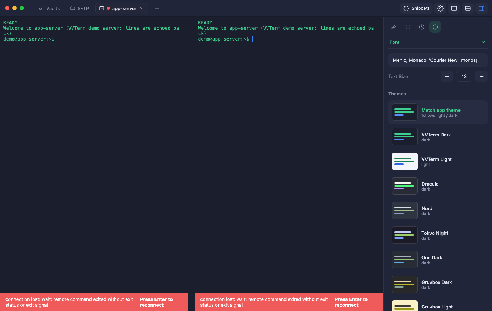

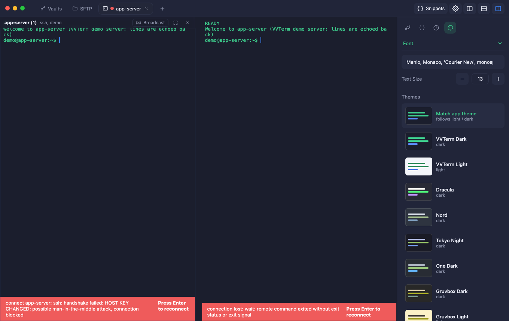

In a narrow window the layout adapts: the navigation becomes icons and the New host panel floats over the list instead of squeezing it.

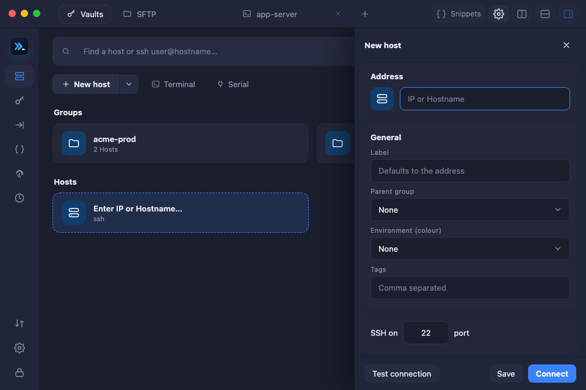

## 16. Where your data lives

| Item | macOS path (`~/Library/Application Support/vvterm/`) |
| --- | --- |
| Hosts, groups, identities (metadata), forwards, snippets, encrypted vault | `data/vvterm.db` (SQLite) |
| Trusted host keys | `data/known_hosts` |
| Appearance, terminal theme, auto-lock, sync URL | `data/settings.json` |
| Git working copy (ciphertext only) | `sync/` |

Set `VVTERM_DATA_DIR` to relocate everything. Back up with **Import / Export → Encrypted backup**; losing the master password without a backup means losing the vault.
