# VVTerm user guide

All screenshots in this guide are produced by the end-to-end walkthrough (`make e2e`) against the real application, so they match the current UI.

## Contents

1. [Create and unlock the vault](#1-create-and-unlock-the-vault)
2. [Add credentials](#2-add-credentials)
3. [Organise hosts](#3-organise-hosts)
4. [Connect](#4-connect)
5. [Split panes and search](#5-split-panes-and-search)
6. [Port forwarding](#6-port-forwarding)
7. [Import and export](#7-import-and-export)
8. [Sync between machines](#8-sync-between-machines)
9. [Settings and security](#9-settings-and-security)
10. [When things go wrong](#10-when-things-go-wrong)
11. [Where your data lives](#11-where-your-data-lives)

## 1. Create and unlock the vault

On first launch choose a master password (at least 12 characters, no recovery is possible). The password only protects the vault; everything else stays usable offline.

After creation you land on the workspace. Double-click a host to open a terminal.

Next time you start the app, or after auto-lock, enter the master password. A wrong password is reported without unlocking anything.

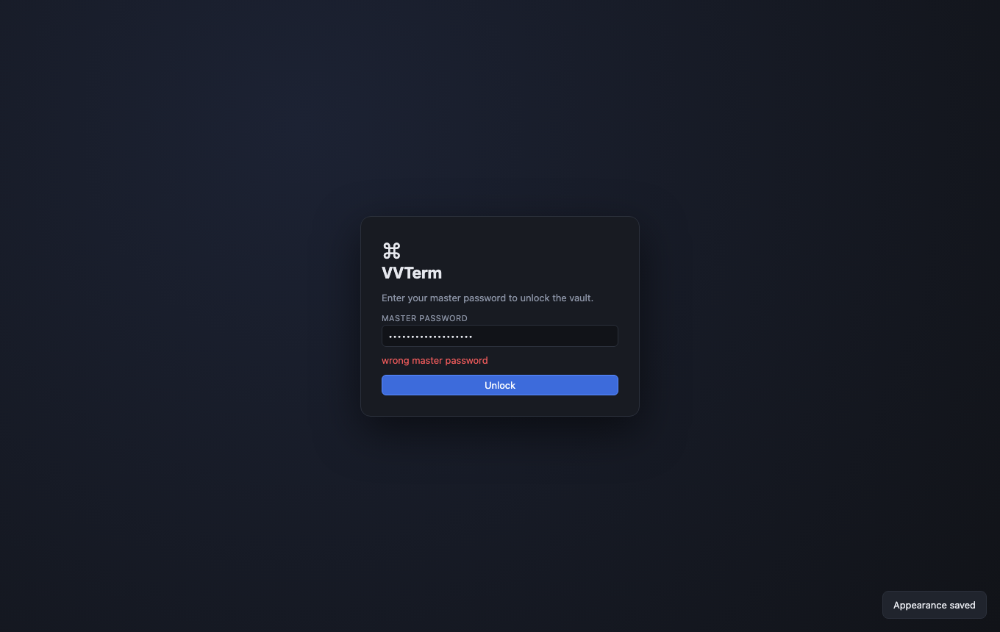

## 2. Add credentials

Open **Vault** in the sidebar. You can:

- **Generate key**: creates an ed25519 key pair. Only the public key is shown; copy it into `~/.ssh/authorized_keys` on your servers.
- **Import key**: from a file or pasted text; supply the passphrase if the key is encrypted (it is stored decrypted *inside* the encrypted vault).
- **Add password** or **ssh-agent** identity.

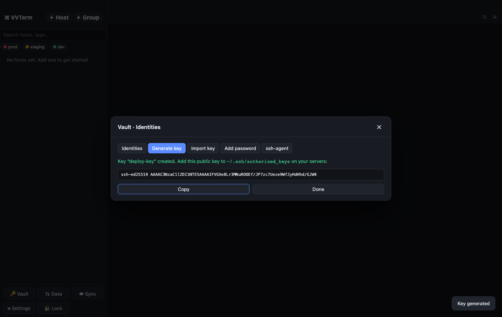

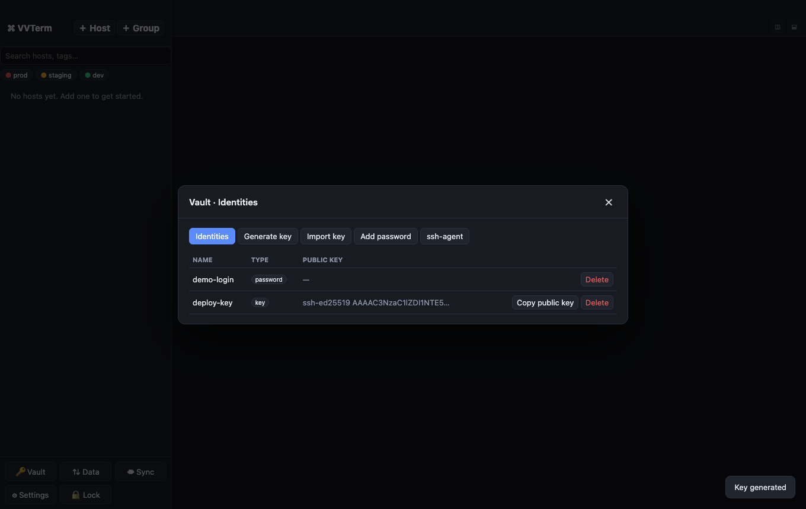

Private keys and passwords never leave the Go backend: the UI only ever sees names and public keys.

## 3. Organise hosts

Use **+ Group** and **+ Host** in the sidebar. A host has a label, address, username, identity, group, environment, tags, optional **jump host** and keepalive interval. The coloured dot shows the environment (red = prod, amber = staging, green = dev).

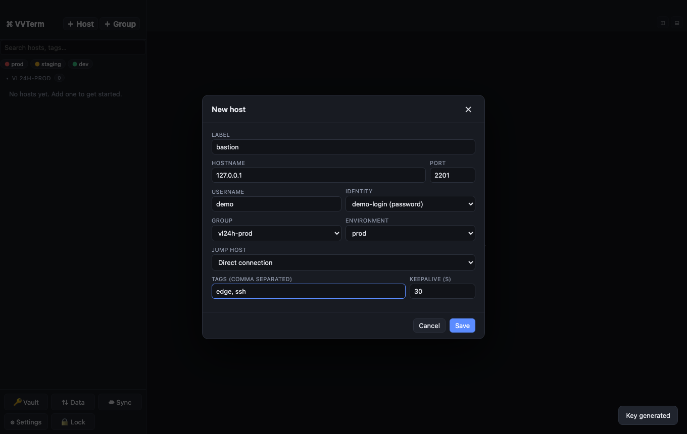

Search matches label, hostname, user and tags; the environment chips filter the list.

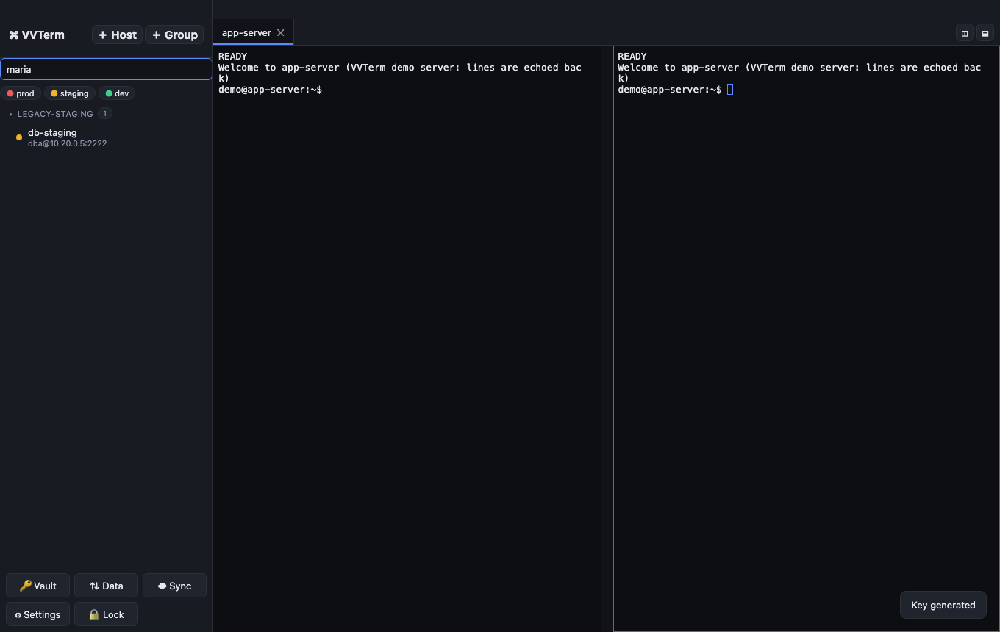

## 4. Connect

Double-click a host (or press ▶). The first time you meet a host, VVTerm shows its fingerprint. Verify it out of band, then choose **Trust and connect**. With a jump host you confirm each machine in the chain once.

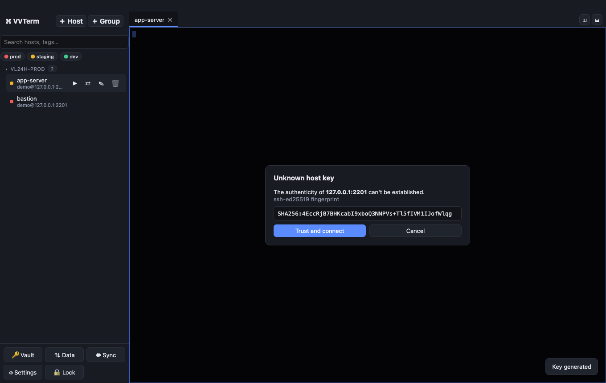

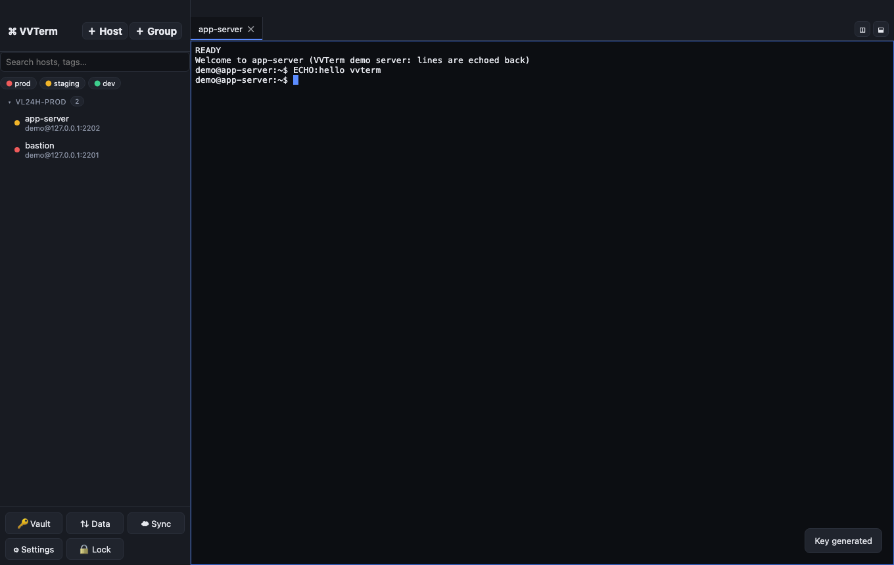

Trusted keys are stored in `known_hosts` (OpenSSH format) and never asked again.

## 5. Split panes and search

Use the buttons at the top right of the tab bar to split the focused pane right or down. Every pane is its own SSH session to the same host. Press **Ctrl/Cmd+F** in a terminal to search its scrollback.

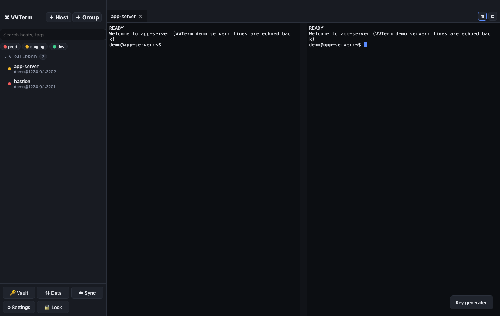

When a shell exits cleanly (`exit`) the pane closes; closing the last pane closes the tab.

## 6. Port forwarding

Hover a host and press ⇄. Add a forward:

| Type | Meaning |
| --- | --- |
| Local (-L) | listen on your machine, connect to a destination through the host |
| Remote (-R) | listen on the server, connect back to a destination on your machine |
| Dynamic (-D) | local SOCKS5 proxy through the host |

Forwards bind to `127.0.0.1`. Binding to another address needs the explicit *Allow binding to a non-loopback address* checkbox. *Start automatically* brings the forward up with the terminal and rebuilds it after you reconnect.

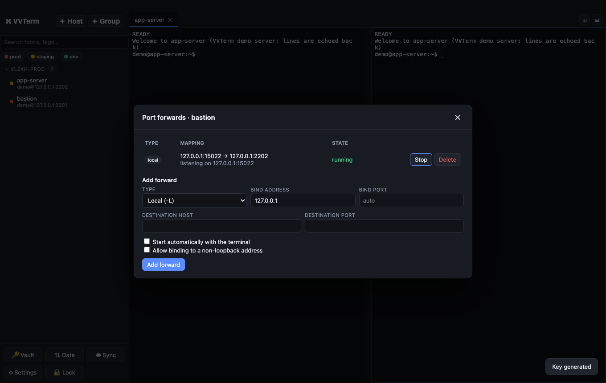

## 7. Import and export

**Data** in the sidebar.

- **Import `~/.ssh/config`**: follows `Include`; the file name inside `config.d/` becomes the group; `ProxyJump` becomes a jump host chain; `LocalForward`/`RemoteForward`/`DynamicForward` become port forwards; `IdentityFile` keys are imported into the vault (vault must be unlocked). Choose what happens when a host name already exists: skip, overwrite or create a copy.
- **Export ssh config**: one file per group. Private keys are only written if you tick the checkbox (a warning is shown; files get mode `0600`).
- **Export host list (JSON)**: metadata only, safe to share.
- **Encrypted backup**: everything including secrets, protected by a *separate* backup password (min. 8 characters).

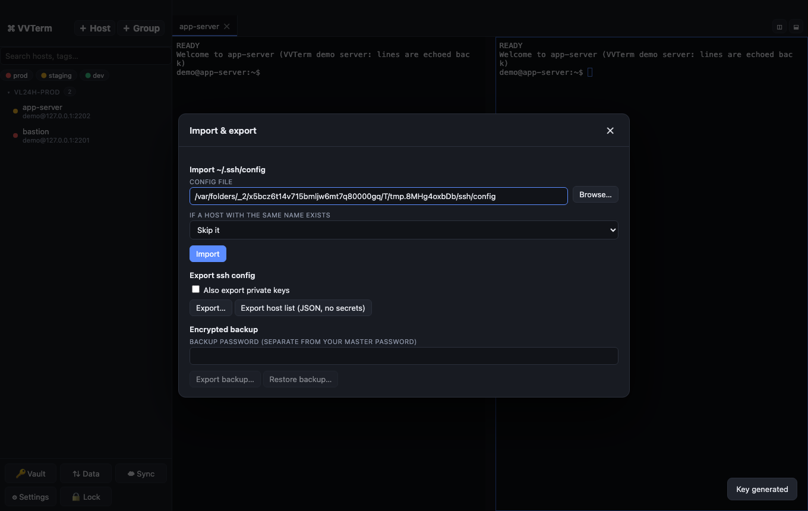

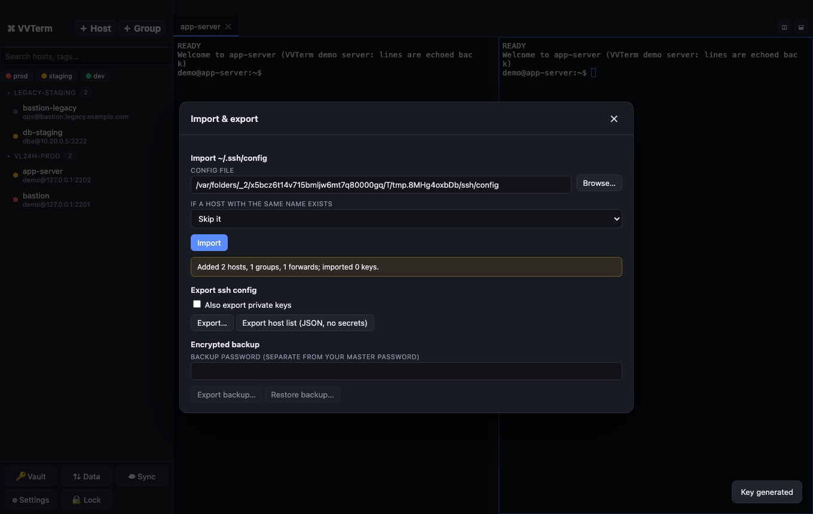

Warnings (for example an unsupported `ProxyCommand`) are listed in the report instead of being silently dropped.

## 8. Sync between machines

1. Create an empty **private** Git repository and make sure `git` on this machine can push to it (ssh-agent or a credential helper).
2. **Sync → Repository URL → Save repository → Sync now.**
3. On a new machine: install VVTerm, open **Sync**, enter the URL, and use **Restore from repository** with the master password of the synced vault (only possible before a local vault exists).

The repository only contains `bundle.enc` and `vault-header.json`, both ciphertext. Hostnames and IPs are not visible to anyone with repo access.

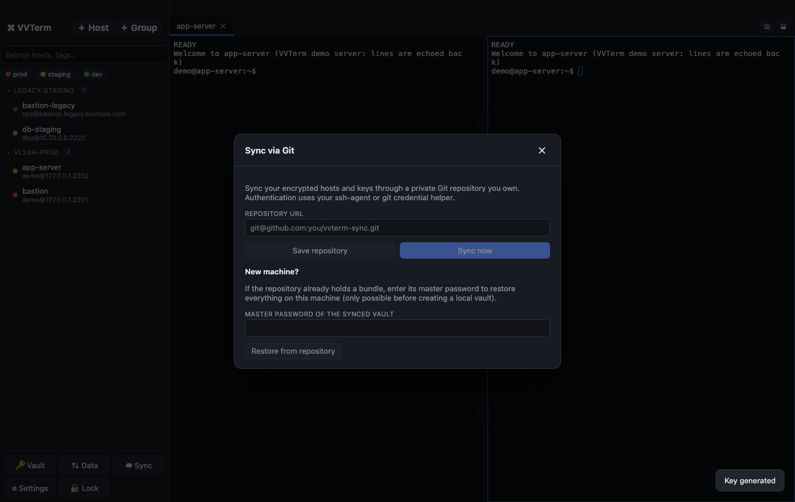

Conflicts are merged per record: the newer `updated_at` wins; a newer edit beats an older delete and vice versa. Machine clocks should be roughly correct.

## 9. Settings and security

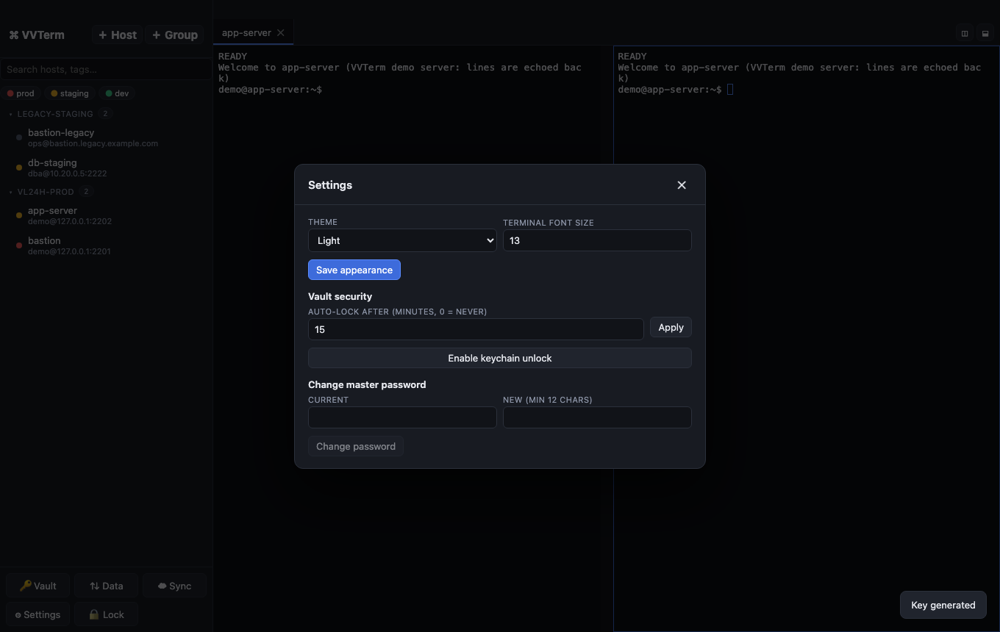

- **Theme** and terminal font size.
- **Auto-lock** after N idle minutes (default 15). The vault wipes its key from memory and the app returns to the unlock screen.
- **Keychain unlock**: stores the vault key in the OS keychain so you can unlock without typing the password. Anyone who can unlock your OS keychain can then open the vault.
- **Change master password**: re-wraps the vault key; secrets are not re-encrypted.

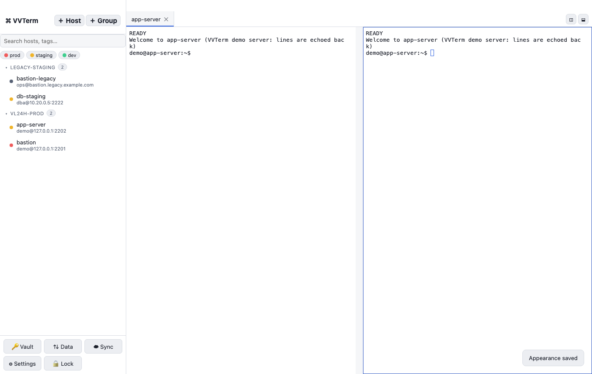

## 10. When things go wrong

| Symptom | Meaning / action |
| --- | --- |
| Red banner *connection lost… Press Enter to reconnect* | The link dropped. VVTerm never reconnects by itself, so commands are not replayed by surprise. Press Enter in the pane. |
| *HOST KEY CHANGED* | The server presents a different key than the one you trusted. The connection is blocked and there is no override. Verify with the server owner; if the change is legitimate remove the old line from `known_hosts` manually. |
| *vault is locked* | Unlock the vault, then retry. |
| *identity is used by host …* | Detach the identity from its hosts before deleting it. |
| Sync error *encrypted with a different vault key* | The repository belongs to another vault. Use a new repository or restore from it on a fresh install. |

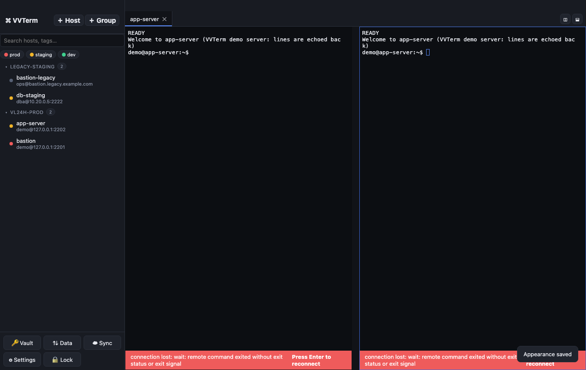

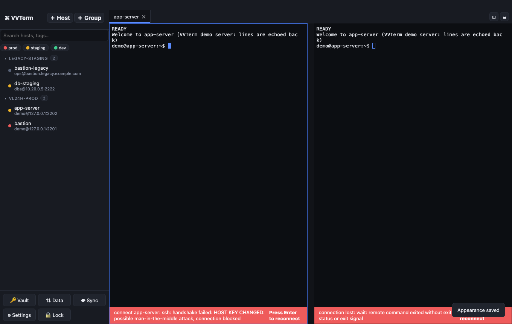

## 11. Where your data lives

| Item | macOS path (`~/Library/Application Support/vvterm/`) |
| --- | --- |
| Hosts, groups, identities metadata, forwards, encrypted vault | `data/vvterm.db` (SQLite) |
| Trusted host keys | `data/known_hosts` |
| Appearance, auto-lock, sync URL | `data/settings.json` |
| Git working copy (ciphertext only) | `sync/` |

Set `VVTERM_DATA_DIR` to relocate everything. Back up with **Data → Encrypted backup**; losing the master password without a backup means losing the vault.
